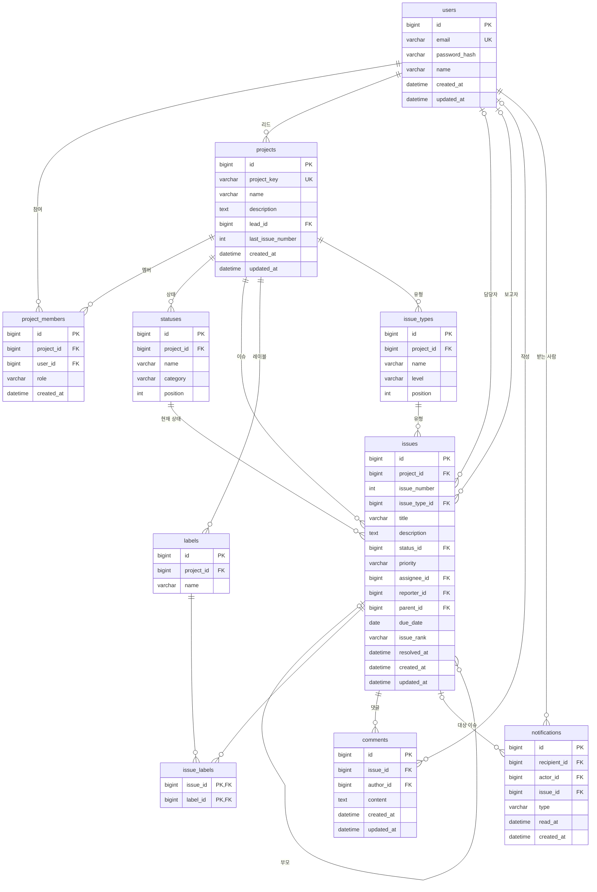

# ERD

[Jira 구조 분석](../analysis/jira-structure.md)의 **MVP 범위**를 기준으로 한 데이터 모델. 다음 단계 기능은 [확장 계획](#확장-계획)에 어디에 붙일지만 적어 둔다.

## 다이어그램



## 공통 규칙

- 테이블·컬럼 이름은 `snake_case`, 테이블은 복수형.
- PK는 `id BIGINT AUTO_INCREMENT`. 연결 테이블(`issue_labels`)만 복합 PK.
- 모든 시간은 UTC로 저장한다. `created_at`, `updated_at`은 JPA Auditing이 채운다.
- 삭제는 모두 **하드 삭제**다 (행을 지운다, 복구 없음). 연결된 데이터는 FK의 ON DELETE로 정리한다. [삭제 시 처리](#삭제-시-처리) 참고.
- 열거형(`role`, `category` …)은 `VARCHAR`에 영문 대문자 문자열로 저장한다 (JPA `@Enumerated(EnumType.STRING)`). DB ENUM 타입은 값 추가가 번거로워 쓰지 않는다.
- `key`, `rank`는 MySQL 예약어라 `project_key`, `issue_rank`로 쓴다.

## 테이블

### users — 사용자

| 컬럼 | 타입 | 제약 | 설명 |
|---|---|---|---|
| id | BIGINT | PK | |
| email | VARCHAR(255) | UK, NOT NULL | 로그인 아이디 |
| password_hash | VARCHAR(255) | NOT NULL | BCrypt 해시 |
| name | VARCHAR(50) | NOT NULL | 표시 이름 |
| created_at, updated_at | DATETIME | NOT NULL | |

### projects — 프로젝트

| 컬럼 | 타입 | 제약 | 설명 |
|---|---|---|---|
| id | BIGINT | PK | |
| project_key | VARCHAR(10) | UK, NOT NULL | 대문자 2~10자. 이슈 키 앞부분 (`SCH`) |
| name | VARCHAR(100) | NOT NULL | |
| description | TEXT | | |
| lead_id | BIGINT | FK → users, NOT NULL | 프로젝트 리드 |
| last_issue_number | INT | NOT NULL, 기본 0 | 마지막으로 발급한 이슈 번호 |
| created_at, updated_at | DATETIME | NOT NULL | |

- `project_key`는 MVP에서 바꿀 수 없다. 바꾸면 이미 공유된 이슈 키(`SCH-12`)가 모두 깨진다.

### project_members — 프로젝트 멤버

| 컬럼 | 타입 | 제약 | 설명 |
|---|---|---|---|
| id | BIGINT | PK | |
| project_id | BIGINT | FK → projects, NOT NULL | |
| user_id | BIGINT | FK → users, NOT NULL | |
| role | VARCHAR(20) | NOT NULL | `ADMIN`, `MEMBER` |
| created_at | DATETIME | NOT NULL | 참여 시각 |

- UK `(project_id, user_id)`: 한 사람은 프로젝트에 한 번만.

### statuses — 상태 (워크플로)

| 컬럼 | 타입 | 제약 | 설명 |
|---|---|---|---|
| id | BIGINT | PK | |
| project_id | BIGINT | FK → projects, NOT NULL | |
| name | VARCHAR(30) | NOT NULL | 표시 이름 (`To Do`, `진행 중` …) |
| category | VARCHAR(20) | NOT NULL | `TODO`, `IN_PROGRESS`, `DONE` |
| position | INT | NOT NULL | 보드 열 순서 (0부터) |

- 프로젝트를 만들 때 기본 상태 3개(`TODO`·`IN_PROGRESS`·`DONE` 분류 하나씩)를 함께 만든다.
- 보드 열 = 상태. MVP에서는 별도 보드 테이블 없이 `position` 순으로 그린다.
- 진행률, 완료 여부는 `name`이 아니라 `category`로 판단한다. 그래야 나중에 `코드 리뷰` 같은 상태를 추가해도 로직이 그대로다.

### issue_types — 이슈 유형

| 컬럼 | 타입 | 제약 | 설명 |
|---|---|---|---|
| id | BIGINT | PK | |
| project_id | BIGINT | FK → projects, NOT NULL | |
| name | VARCHAR(30) | NOT NULL | 표시 이름 (`에픽`, `스토리`, `개선` …) |
| level | VARCHAR(20) | NOT NULL | 계층 단계. `EPIC`, `STANDARD`, `SUBTASK` |
| position | INT | NOT NULL | 유형 선택 목록 순서 (0부터) |

- UK `(project_id, name)`.
- `statuses`와 같은 구조다. **계층(level) 3개는 고정**이고, 유저는 그 아래에 유형을 만들어 넣는다.
- 프로젝트를 만들 때 기본 유형 5개를 함께 만든다.

| name | level |
|---|---|
| 에픽 | `EPIC` |
| 스토리 | `STANDARD` |
| 작업 | `STANDARD` |
| 버그 | `STANDARD` |
| 하위 작업 | `SUBTASK` |

- 계층 규칙(부모 관계)은 `name`이 아니라 `level`로 판단한다. 유저가 `개선`(`STANDARD`)을 만들면 스토리·작업·버그와 똑같이 동작한다.

### issues — 이슈

| 컬럼 | 타입 | 제약 | 설명 |
|---|---|---|---|
| id | BIGINT | PK | |
| project_id | BIGINT | FK → projects, NOT NULL | |
| issue_number | INT | NOT NULL | 프로젝트 안의 순번. 키 = `project_key` + `-` + `issue_number` |
| issue_type_id | BIGINT | FK → issue_types, NOT NULL | 같은 프로젝트의 유형만 |
| title | VARCHAR(255) | NOT NULL | 요약 |
| description | TEXT | | 마크다운 |
| status_id | BIGINT | FK → statuses, NOT NULL | 같은 프로젝트의 상태만 |
| priority | VARCHAR(20) | NOT NULL, 기본 `MEDIUM` | `HIGHEST`, `HIGH`, `MEDIUM`, `LOW`, `LOWEST` |
| assignee_id | BIGINT | FK → users | 담당자 (없을 수 있음) |
| reporter_id | BIGINT | FK → users | 보고자. 탈퇴하면 NULL |
| parent_id | BIGINT | FK → issues | 상위 이슈 |
| due_date | DATE | | 기한 |
| issue_rank | VARCHAR(255) | NOT NULL | 보드·백로그 순서. 문자열 사전순 정렬 |
| resolved_at | DATETIME | | `DONE` 분류 상태로 들어간 시각. 나가면 NULL |
| created_at, updated_at | DATETIME | NOT NULL | |

- UK `(project_id, issue_number)`.
- 인덱스 `(project_id, status_id, issue_rank)`: 보드 조회. `(assignee_id)`: 내 이슈 조회.
- **이슈 번호 발급**: `projects` 행을 `SELECT … FOR UPDATE`로 잠그고 `last_issue_number + 1`을 쓴다. `MAX(issue_number) + 1`은 동시에 만들면 번호가 겹친다.
- **순서(rank)**: 두 이슈 사이에 끼울 때 앞뒤 값의 중간 문자열을 만든다 (fractional indexing). 다른 이슈의 값을 바꾸지 않아 드래그 한 번에 행 하나만 수정된다.
- **부모 규칙** (DB가 아니라 서비스에서 검사):

| 유형의 level | parent_id |
|---|---|
| `EPIC` | 항상 NULL |
| `STANDARD` | NULL 또는 같은 프로젝트의 `EPIC` 이슈 |
| `SUBTASK` | 필수. 같은 프로젝트의 `STANDARD` 이슈 |

### labels — 레이블

| 컬럼 | 타입 | 제약 | 설명 |
|---|---|---|---|
| id | BIGINT | PK | |
| project_id | BIGINT | FK → projects, NOT NULL | |
| name | VARCHAR(50) | NOT NULL | |

- UK `(project_id, name)`. 이슈에 처음 붙일 때 없으면 만든다.

### issue_labels — 이슈 ↔ 레이블

| 컬럼 | 타입 | 제약 | 설명 |
|---|---|---|---|
| issue_id | BIGINT | PK, FK → issues | |
| label_id | BIGINT | PK, FK → labels | |

### comments — 댓글

| 컬럼 | 타입 | 제약 | 설명 |
|---|---|---|---|
| id | BIGINT | PK | |
| issue_id | BIGINT | FK → issues, NOT NULL | |
| author_id | BIGINT | FK → users | 탈퇴하면 NULL |
| content | TEXT | NOT NULL | 마크다운. 멘션은 `@{userId}` 형태로 저장 |
| created_at, updated_at | DATETIME | NOT NULL | `updated_at`이 다르면 "수정됨" 표시 |

### notifications — 알림

| 컬럼 | 타입 | 제약 | 설명 |
|---|---|---|---|
| id | BIGINT | PK | |
| recipient_id | BIGINT | FK → users, NOT NULL | 받는 사람 |
| actor_id | BIGINT | FK → users, NOT NULL | 행동한 사람 |
| issue_id | BIGINT | FK → issues | 대상 이슈 |
| type | VARCHAR(30) | NOT NULL | `ASSIGNED`, `MENTIONED`, `COMMENTED`, `STATUS_CHANGED` |
| read_at | DATETIME | | NULL이면 안 읽음 |
| created_at | DATETIME | NOT NULL | |

- 인덱스 `(recipient_id, read_at, created_at)`: 안 읽은 알림 수, 최신순 목록.
- 자기가 한 행동은 자기에게 알리지 않는다 (`actor_id = recipient_id`면 만들지 않음).

## 삭제 시 처리

모든 삭제가 하드 삭제라 FK마다 삭제 동작을 정한다.

### 프로젝트 삭제

프로젝트를 지우면 딸린 데이터가 모두 지워진다. 되돌릴 수 없으므로 화면에서 프로젝트 키를 입력받아 확인한다.

| FK | ON DELETE |
|---|---|
| `project_members.project_id`, `statuses.project_id`, `issue_types.project_id`, `issues.project_id`, `labels.project_id` | CASCADE |
| `comments.issue_id`, `issue_labels.issue_id`, `issue_labels.label_id`, `notifications.issue_id` | CASCADE (이슈·레이블이 지워질 때 함께) |

- `issues.status_id`, `issues.issue_type_id`도 CASCADE다. 프로젝트를 지울 때 상태·유형과 이슈가 함께 지워지므로 막히지 않게 한다. 상태·유형 하나만 지울 때는 **서비스에서 그 상태·유형의 이슈를 다른 것으로 옮긴 뒤** 지운다 (CASCADE로 이슈가 지워지지 않게).

### 이슈 삭제

| FK | ON DELETE | 이유 |
|---|---|---|
| `comments.issue_id`, `issue_labels.issue_id`, `notifications.issue_id` | CASCADE | 이슈에 딸린 데이터 |
| `issues.parent_id` | SET NULL | 에픽을 지워도 그 아래 이슈는 남긴다 |

- `SUBTASK` 계층은 부모가 필수라, `STANDARD` 이슈를 지울 때 **하위 작업은 서비스에서 먼저 지운다.** FK를 CASCADE로 두면 에픽을 지울 때 아래 이슈까지 모두 사라져서 SET NULL로 둔다.

### 사용자 삭제 (탈퇴)

| FK | ON DELETE | 이유 |
|---|---|---|
| `project_members.user_id` | CASCADE | 멤버십은 사람과 함께 사라진다 |
| `notifications.recipient_id`, `actor_id` | CASCADE | 받을 사람·보낸 사람이 없으면 의미 없다 |
| `issues.assignee_id` | SET NULL | 미배정으로 돌아간다 |
| `issues.reporter_id`, `comments.author_id` | SET NULL | 이슈·댓글은 남기고 작성자는 "알 수 없는 사용자"로 표시 |
| `projects.lead_id` | RESTRICT | 리드인 프로젝트가 있으면 탈퇴를 막는다. 리드를 넘기거나 프로젝트를 지운 뒤 탈퇴한다 |

## 확장 계획

MVP 다음 단계 기능을 붙일 자리. 지금은 만들지 않는다.

| 기능 | 붙이는 방법 |
|---|---|
| 스프린트 | `sprints`(project_id, name, goal, state, start_date, end_date) + `issues.sprint_id` |
| 첨부파일 | `attachments`(issue_id, uploader_id, file_name, url, size) |
| 이슈 링크 | `issue_links`(source_issue_id, target_issue_id, link_type) |
| 변경 이력 | `issue_histories`(issue_id, actor_id, field, old_value, new_value, created_at) |
| 관찰자 | `issue_watchers`(issue_id, user_id) — 복합 PK |
| 워크플로 커스터마이징 | `statuses`에 행 추가 + `status_transitions`(from_status_id, to_status_id) |
| 컴포넌트 · 버전 | `components`, `versions` + 이슈 연결 테이블 |
| 보드 여러 개 | `boards`(project_id, filter) + `board_columns`(board_id, status_id) |

## DBML

[dbdiagram.io](https://dbdiagram.io)에 붙여 넣으면 다이어그램이 그려진다. 테이블을 바꾸면 이 코드와 위 다이어그램·표를 함께 고친다.

```dbml
Project scheduler {
  database_type: 'MySQL'
}

Table users {
  id bigint [pk, increment]
  email varchar(255) [not null, unique]
  password_hash varchar(255) [not null]
  name varchar(50) [not null]
  created_at datetime [not null]
  updated_at datetime [not null]
}

Table projects {
  id bigint [pk, increment]
  project_key varchar(10) [not null, unique, note: '대문자 2~10자. 변경 불가']
  name varchar(100) [not null]
  description text
  lead_id bigint [not null]
  last_issue_number int [not null, default: 0]
  created_at datetime [not null]
  updated_at datetime [not null]
}

Table project_members {
  id bigint [pk, increment]
  project_id bigint [not null]
  user_id bigint [not null]
  role varchar(20) [not null, note: 'ADMIN, MEMBER']
  created_at datetime [not null]

  indexes {
    (project_id, user_id) [unique]
  }
}

Table statuses {
  id bigint [pk, increment]
  project_id bigint [not null]
  name varchar(30) [not null]
  category varchar(20) [not null, note: 'TODO, IN_PROGRESS, DONE']
  position int [not null, note: '보드 열 순서']
}

Table issue_types {
  id bigint [pk, increment]
  project_id bigint [not null]
  name varchar(30) [not null]
  level varchar(20) [not null, note: 'EPIC, STANDARD, SUBTASK']
  position int [not null, note: '유형 선택 목록 순서']

  indexes {
    (project_id, name) [unique]
  }
}

Table issues {
  id bigint [pk, increment]
  project_id bigint [not null]
  issue_number int [not null, note: '키 = project_key-issue_number']
  issue_type_id bigint [not null]
  title varchar(255) [not null]
  description text
  status_id bigint [not null]
  priority varchar(20) [not null, default: 'MEDIUM', note: 'HIGHEST, HIGH, MEDIUM, LOW, LOWEST']
  assignee_id bigint
  reporter_id bigint
  parent_id bigint
  due_date date
  issue_rank varchar(255) [not null, note: 'fractional indexing']
  resolved_at datetime
  created_at datetime [not null]
  updated_at datetime [not null]

  indexes {
    (project_id, issue_number) [unique]
    (project_id, status_id, issue_rank)
    assignee_id
  }
}

Table labels {
  id bigint [pk, increment]
  project_id bigint [not null]
  name varchar(50) [not null]

  indexes {
    (project_id, name) [unique]
  }
}

Table issue_labels {
  issue_id bigint [not null]
  label_id bigint [not null]

  indexes {
    (issue_id, label_id) [pk]
  }
}

Table comments {
  id bigint [pk, increment]
  issue_id bigint [not null]
  author_id bigint
  content text [not null]
  created_at datetime [not null]
  updated_at datetime [not null]
}

Table notifications {
  id bigint [pk, increment]
  recipient_id bigint [not null]
  actor_id bigint [not null]
  issue_id bigint
  type varchar(30) [not null, note: 'ASSIGNED, MENTIONED, COMMENTED, STATUS_CHANGED']
  read_at datetime
  created_at datetime [not null]

  indexes {
    (recipient_id, read_at, created_at)
  }
}

// 삭제는 모두 하드 삭제. 프로젝트·이슈를 지우면 딸린 데이터를 함께 지운다
Ref: project_members.project_id > projects.id [delete: cascade]
Ref: statuses.project_id > projects.id [delete: cascade]
Ref: issues.project_id > projects.id [delete: cascade]
Ref: labels.project_id > projects.id [delete: cascade]
Ref: issues.status_id > statuses.id [delete: cascade]
Ref: issue_types.project_id > projects.id [delete: cascade]
Ref: issues.issue_type_id > issue_types.id [delete: cascade]
Ref: issues.parent_id > issues.id [delete: set null]
Ref: issue_labels.issue_id > issues.id [delete: cascade]
Ref: issue_labels.label_id > labels.id [delete: cascade]
Ref: comments.issue_id > issues.id [delete: cascade]
Ref: notifications.issue_id > issues.id [delete: cascade]

// 사용자는 하드 삭제. FK마다 삭제 동작을 정한다
Ref: projects.lead_id > users.id [delete: restrict]
Ref: project_members.user_id > users.id [delete: cascade]
Ref: issues.assignee_id > users.id [delete: set null]
Ref: issues.reporter_id > users.id [delete: set null]
Ref: comments.author_id > users.id [delete: set null]
Ref: notifications.recipient_id > users.id [delete: cascade]
Ref: notifications.actor_id > users.id [delete: cascade]
```
