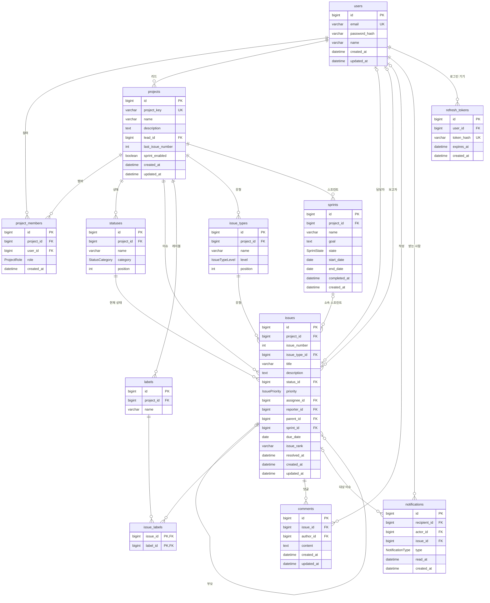

# ERD

[Jira 구조 분석](../analysis/jira-structure.md)의 **MVP 범위**를 기준으로 한 데이터 모델. 다음 단계 기능은 [확장 계획](#확장-계획)에 어디에 붙일지만 적어 둔다.

## 다이어그램



## 공통 규칙

- 테이블·컬럼 이름은 `snake_case`, 테이블은 복수형.
- PK는 `id BIGINT AUTO_INCREMENT`. 연결 테이블(`issue_labels`)만 복합 PK.
- 모든 시간은 UTC로 저장한다. `created_at`, `updated_at`은 JPA Auditing이 채운다.
- 삭제는 모두 **하드 삭제**다 (행을 지운다, 복구 없음). 연결된 데이터는 FK의 ON DELETE로 정리한다. [삭제 시 처리](#삭제-시-처리) 참고.
- 값이 정해진 컬럼은 **enum**으로 표시한다 ([열거형](#열거형)). DB에는 `VARCHAR`에 영문 대문자 문자열로 저장한다 (JPA `@Enumerated(EnumType.STRING)`). DB ENUM 타입은 값 추가가 번거로워 쓰지 않는다.
- `key`, `rank`는 MySQL 예약어라 `project_key`, `issue_rank`로 쓴다.

## 열거형

값이 고정이라 코드(Java enum)로 관리하는 것들. 유저가 늘리는 값(상태, 이슈 유형, 레이블)은 테이블로 둔다.

| enum | 컬럼 | 값 |
|---|---|---|
| `ProjectRole` | `project_members.role` | `ADMIN`(관리자), `MEMBER`(멤버) |
| `StatusCategory` | `statuses.category` | `TODO`(할 일), `IN_PROGRESS`(진행 중), `DONE`(완료) |
| `IssueTypeLevel` | `issue_types.level` | `EPIC`(에픽), `STANDARD`(일반), `SUBTASK`(하위 작업) |
| `SprintState` | `sprints.state` | `FUTURE`(계획), `ACTIVE`(진행 중), `CLOSED`(종료) |
| `IssuePriority` | `issues.priority` | `HIGHEST`, `HIGH`, `MEDIUM`, `LOW`, `LOWEST` |
| `NotificationType` | `notifications.type` | `ASSIGNED`(담당 지정), `MENTIONED`(멘션), `COMMENTED`(댓글), `STATUS_CHANGED`(상태 변경) |

- 스프린트 상태는 날짜로 자동으로 바뀌지 않는다. 관리자가 시작·완료할 때만 바뀐다.

## 테이블

### users — 사용자

| 컬럼 | 타입 | 제약 | 설명 |
|---|---|---|---|
| id | BIGINT | PK | |
| email | VARCHAR(255) | UK, NOT NULL | 로그인 아이디 |
| password_hash | VARCHAR(255) | NOT NULL | BCrypt 해시 |
| name | VARCHAR(50) | NOT NULL | 표시 이름 |
| created_at, updated_at | DATETIME | NOT NULL | |

### refresh_tokens — 리프레시 토큰

| 컬럼 | 타입 | 제약 | 설명 |
|---|---|---|---|
| id | BIGINT | PK | |
| user_id | BIGINT | FK → users, NOT NULL | |
| token_hash | VARCHAR(64) | UK, NOT NULL | 리프레시 토큰의 SHA-256 해시. 원문은 저장하지 않는다 |
| expires_at | DATETIME | NOT NULL | 발급 + 14일 |
| created_at | DATETIME | NOT NULL | |

- 로그인할 때마다 한 행 (기기마다 따로 로그인 유지).
- 재발급하면 쓴 행을 지우고 새 행을 만든다 (한 번 쓰면 무효).
- 로그아웃하면 그 행을, 비밀번호 변경 · 탈퇴하면 그 사용자의 모든 행을 지운다.
- 만료된 행은 하루 한 번 지운다.

### projects — 프로젝트

| 컬럼 | 타입 | 제약 | 설명 |
|---|---|---|---|
| id | BIGINT | PK | |
| project_key | VARCHAR(10) | UK, NOT NULL | 대문자 2~10자. 이슈 키 앞부분 (`SCH`) |
| name | VARCHAR(100) | NOT NULL | |
| description | TEXT | | |
| lead_id | BIGINT | FK → users, NOT NULL | 프로젝트 리드 |
| last_issue_number | INT | NOT NULL, 기본 0 | 마지막으로 발급한 이슈 번호 |
| sprint_enabled | BOOLEAN | NOT NULL, 기본 TRUE | 스프린트 사용 여부. 끄면 백로그·스프린트 없이 보드에 모든 이슈 (칸반) |
| created_at, updated_at | DATETIME | NOT NULL | |

- `project_key`는 MVP에서 바꿀 수 없다. 바꾸면 이미 공유된 이슈 키(`SCH-12`)가 모두 깨진다.

### project_members — 프로젝트 멤버

| 컬럼 | 타입 | 제약 | 설명 |
|---|---|---|---|
| id | BIGINT | PK | |
| project_id | BIGINT | FK → projects, NOT NULL | |
| user_id | BIGINT | FK → users, NOT NULL | |
| role | enum `ProjectRole` | NOT NULL | `ADMIN`, `MEMBER` |
| created_at | DATETIME | NOT NULL | 참여 시각 |

- UK `(project_id, user_id)`: 한 사람은 프로젝트에 한 번만.

### statuses — 상태 (워크플로)

| 컬럼 | 타입 | 제약 | 설명 |
|---|---|---|---|
| id | BIGINT | PK | |
| project_id | BIGINT | FK → projects, NOT NULL | |
| name | VARCHAR(30) | NOT NULL | 표시 이름 (`To Do`, `진행 중` …) |
| category | enum `StatusCategory` | NOT NULL | `TODO`, `IN_PROGRESS`, `DONE` |
| position | INT | NOT NULL | 보드 열 순서 (0부터) |

- 프로젝트를 만들 때 기본 상태 3개(`TODO`·`IN_PROGRESS`·`DONE` 분류 하나씩)를 함께 만든다.
- 보드 열 = 상태. MVP에서는 별도 보드 테이블 없이 `position` 순으로 그린다.
- 진행률, 완료 여부는 `name`이 아니라 `category`로 판단한다. 그래야 나중에 `코드 리뷰` 같은 상태를 추가해도 로직이 그대로다.

### issue_types — 이슈 유형

| 컬럼 | 타입 | 제약 | 설명 |
|---|---|---|---|
| id | BIGINT | PK | |
| project_id | BIGINT | FK → projects, NOT NULL | |
| name | VARCHAR(30) | NOT NULL | 표시 이름 (`에픽`, `스토리`, `개선` …) |
| level | enum `IssueTypeLevel` | NOT NULL | 계층 단계. `EPIC`, `STANDARD`, `SUBTASK` |
| position | INT | NOT NULL | 유형 선택 목록 순서 (0부터) |

- UK `(project_id, name)`.
- `statuses`와 같은 구조다. **계층(level) 3개는 고정**이고, 유저는 그 아래에 유형을 만들어 넣는다.
- 프로젝트를 만들 때 기본 유형 5개를 함께 만든다.

| name | level |
|---|---|
| 에픽 | `EPIC` |
| 스토리 | `STANDARD` |
| 작업 | `STANDARD` |
| 버그 | `STANDARD` |
| 하위 작업 | `SUBTASK` |

- 계층 규칙(부모 관계)은 `name`이 아니라 `level`로 판단한다. 유저가 `개선`(`STANDARD`)을 만들면 스토리·작업·버그와 똑같이 동작한다.

### sprints — 스프린트

| 컬럼 | 타입 | 제약 | 설명 |
|---|---|---|---|
| id | BIGINT | PK | |
| project_id | BIGINT | FK → projects, NOT NULL | |
| name | VARCHAR(100) | NOT NULL | 기본값 `{프로젝트 키} 스프린트 {n}` |
| goal | TEXT | | 스프린트 목표 |
| state | enum `SprintState` | NOT NULL, 기본 `FUTURE` | `FUTURE`(계획), `ACTIVE`(진행 중), `CLOSED`(종료). 시작·완료 버튼으로만 바뀐다 |
| start_date | DATE | | 시작할 때 정한다 |
| end_date | DATE | | 시작할 때 정한다 |
| completed_at | DATETIME | | 완료한 시각 |
| created_at | DATETIME | NOT NULL | |

- 인덱스 `(project_id, state)`: 진행 중 스프린트, 계획된 스프린트 목록.
- **진행 중(`ACTIVE`) 스프린트는 프로젝트당 1개.** DB 제약이 아니라 서비스에서 `projects` 행을 잠그고 검사한다.
- 이슈는 스프린트 **하나에만** 속한다 (`issues.sprint_id`). 완료 때 다음 스프린트로 넘어간 이슈는 이전 스프린트 기록이 남지 않는다 (변경 이력이 생기면 그쪽에서 추적).

### issues — 이슈

| 컬럼 | 타입 | 제약 | 설명 |
|---|---|---|---|
| id | BIGINT | PK | |
| project_id | BIGINT | FK → projects, NOT NULL | |
| issue_number | INT | NOT NULL | 프로젝트 안의 순번. 키 = `project_key` + `-` + `issue_number` |
| issue_type_id | BIGINT | FK → issue_types, NOT NULL | 같은 프로젝트의 유형만 |
| title | VARCHAR(255) | NOT NULL | 요약 |
| description | TEXT | | 마크다운 |
| status_id | BIGINT | FK → statuses, NOT NULL | 같은 프로젝트의 상태만 |
| priority | enum `IssuePriority` | NOT NULL, 기본 `MEDIUM` | `HIGHEST`, `HIGH`, `MEDIUM`, `LOW`, `LOWEST` |
| assignee_id | BIGINT | FK → users | 담당자 (없을 수 있음) |
| reporter_id | BIGINT | FK → users | 보고자. 탈퇴하면 NULL |
| parent_id | BIGINT | FK → issues | 상위 이슈 |
| sprint_id | BIGINT | FK → sprints | 속한 스프린트. NULL이면 백로그 |
| due_date | DATE | | 기한 |
| issue_rank | VARCHAR(255) | NOT NULL | 보드·백로그 순서. 문자열 사전순 정렬 |
| resolved_at | DATETIME | | `DONE` 분류 상태로 들어간 시각. 나가면 NULL |
| created_at, updated_at | DATETIME | NOT NULL | |

- UK `(project_id, issue_number)`.
- 인덱스 `(sprint_id, status_id, issue_rank)`: 보드 조회 (진행 중 스프린트). `(project_id, sprint_id, issue_rank)`: 백로그 조회. `(assignee_id)`: 내 이슈 조회.
- **이슈 번호 발급**: `projects` 행을 `SELECT … FOR UPDATE`로 잠그고 `last_issue_number + 1`을 쓴다. `MAX(issue_number) + 1`은 동시에 만들면 번호가 겹친다.
- **순서(rank)**: 두 이슈 사이에 끼울 때 앞뒤 값의 중간 문자열을 만든다 (fractional indexing). 다른 이슈의 값을 바꾸지 않아 드래그 한 번에 행 하나만 수정된다.
- **부모 규칙** (DB가 아니라 서비스에서 검사):

| 유형의 level | parent_id |
|---|---|
| `EPIC` | 항상 NULL |
| `STANDARD` | NULL 또는 같은 프로젝트의 `EPIC` 이슈 |
| `SUBTASK` | 필수. 같은 프로젝트의 `STANDARD` 이슈 |

### labels — 레이블

| 컬럼 | 타입 | 제약 | 설명 |
|---|---|---|---|
| id | BIGINT | PK | |
| project_id | BIGINT | FK → projects, NOT NULL | |
| name | VARCHAR(50) | NOT NULL | |

- UK `(project_id, name)`. 이슈에 처음 붙일 때 없으면 만든다.

### issue_labels — 이슈 ↔ 레이블

| 컬럼 | 타입 | 제약 | 설명 |
|---|---|---|---|
| issue_id | BIGINT | PK, FK → issues | |
| label_id | BIGINT | PK, FK → labels | |

### comments — 댓글

| 컬럼 | 타입 | 제약 | 설명 |
|---|---|---|---|
| id | BIGINT | PK | |
| issue_id | BIGINT | FK → issues, NOT NULL | |
| author_id | BIGINT | FK → users | 탈퇴하면 NULL |
| content | TEXT | NOT NULL | 마크다운. 멘션은 `@{userId}` 형태로 저장 |
| created_at, updated_at | DATETIME | NOT NULL | `updated_at`이 다르면 "수정됨" 표시 |

### notifications — 알림

| 컬럼 | 타입 | 제약 | 설명 |
|---|---|---|---|
| id | BIGINT | PK | |
| recipient_id | BIGINT | FK → users, NOT NULL | 받는 사람 |
| actor_id | BIGINT | FK → users, NOT NULL | 행동한 사람 |
| issue_id | BIGINT | FK → issues | 대상 이슈 |
| type | enum `NotificationType` | NOT NULL | `ASSIGNED`, `MENTIONED`, `COMMENTED`, `STATUS_CHANGED` |
| read_at | DATETIME | | NULL이면 안 읽음 |
| created_at | DATETIME | NOT NULL | |

- 인덱스 `(recipient_id, read_at, created_at)`: 안 읽은 알림 수, 최신순 목록.
- 자기가 한 행동은 자기에게 알리지 않는다 (`actor_id = recipient_id`면 만들지 않음).

## 삭제 시 처리

모든 삭제가 하드 삭제라 FK마다 삭제 동작을 정한다.

### 프로젝트 삭제

프로젝트를 지우면 딸린 데이터가 모두 지워진다. 되돌릴 수 없으므로 화면에서 프로젝트 키를 입력받아 확인한다.

| FK | ON DELETE |
|---|---|
| `project_members.project_id`, `statuses.project_id`, `issue_types.project_id`, `sprints.project_id`, `issues.project_id`, `labels.project_id` | CASCADE |
| `comments.issue_id`, `issue_labels.issue_id`, `issue_labels.label_id`, `notifications.issue_id` | CASCADE (이슈·레이블이 지워질 때 함께) |

- `issues.status_id`, `issues.issue_type_id`도 CASCADE다. 프로젝트를 지울 때 상태·유형과 이슈가 함께 지워지므로 막히지 않게 한다. 상태·유형 하나만 지울 때는 **서비스에서 그 상태·유형의 이슈를 다른 것으로 옮긴 뒤** 지운다 (CASCADE로 이슈가 지워지지 않게).

### 이슈 삭제

| FK | ON DELETE | 이유 |
|---|---|---|
| `comments.issue_id`, `issue_labels.issue_id`, `notifications.issue_id` | CASCADE | 이슈에 딸린 데이터 |
| `issues.parent_id` | SET NULL | 에픽을 지워도 그 아래 이슈는 남긴다 |

- `SUBTASK` 계층은 부모가 필수라, `STANDARD` 이슈를 지울 때 **하위 작업은 서비스에서 먼저 지운다.** FK를 CASCADE로 두면 에픽을 지울 때 아래 이슈까지 모두 사라져서 SET NULL로 둔다.

### 스프린트 삭제

| FK | ON DELETE | 이유 |
|---|---|---|
| `issues.sprint_id` | SET NULL | 스프린트를 지우면 그 이슈는 백로그로 돌아간다 |

### 사용자 삭제 (탈퇴)

| FK | ON DELETE | 이유 |
|---|---|---|
| `project_members.user_id` | CASCADE | 멤버십은 사람과 함께 사라진다 |
| `refresh_tokens.user_id` | CASCADE | 로그인 상태도 함께 사라진다 |
| `notifications.recipient_id`, `actor_id` | CASCADE | 받을 사람·보낸 사람이 없으면 의미 없다 |
| `issues.assignee_id` | SET NULL | 미배정으로 돌아간다 |
| `issues.reporter_id`, `comments.author_id` | SET NULL | 이슈·댓글은 남기고 작성자는 "알 수 없는 사용자"로 표시 |
| `projects.lead_id` | RESTRICT | 리드인 프로젝트가 있으면 탈퇴를 막는다. 리드를 넘기거나 프로젝트를 지운 뒤 탈퇴한다 |

## 확장 계획

MVP 다음 단계 기능을 붙일 자리. 지금은 만들지 않는다.

| 기능 | 붙이는 방법 |
|---|---|
| 첨부파일 | `attachments`(issue_id, uploader_id, file_name, url, size) |
| 이슈 링크 | `issue_links`(source_issue_id, target_issue_id, link_type) |
| 변경 이력 | `issue_histories`(issue_id, actor_id, field, old_value, new_value, created_at) |
| 관찰자 | `issue_watchers`(issue_id, user_id) — 복합 PK |
| 워크플로 커스터마이징 | `statuses`에 행 추가 + `status_transitions`(from_status_id, to_status_id) |
| 컴포넌트 · 버전 | `components`, `versions` + 이슈 연결 테이블 |
| 보드 여러 개 | `boards`(project_id, filter) + `board_columns`(board_id, status_id) |
| 사용자가 꾸미는 대시보드 | `dashboards`(name, owner_id) + `dashboard_widgets`(dashboard_id, type, position, config JSON) + `saved_filters` |
| 번다운 · 누적 흐름도 | 변경 이력(`issue_histories`)에서 날짜별 상태를 계산. 포인트 기준이면 `issues.story_points` 추가 |

## DBML

[dbdiagram.io](https://dbdiagram.io)에 붙여 넣으면 다이어그램이 그려진다. 테이블·컬럼에 마우스를 올리면 설명(note)이 보인다. 테이블을 바꾸면 이 코드와 위 다이어그램·표를 함께 고친다.

```dbml
Project scheduler {
  database_type: 'MySQL'
  Note: '''
  Jira 비슷한 이슈 트래커 MVP 데이터 모델.
  - 삭제는 모두 하드 삭제. 연결 데이터는 FK의 ON DELETE로 정리한다.
  - 시간은 모두 UTC. created_at, updated_at은 JPA Auditing이 채운다.
  - Enum은 표시용이다. 실제 DB에는 VARCHAR(영문 대문자 문자열)로 저장한다.
  '''
}

// ───────────── 열거형 (실제 DB에는 VARCHAR로 저장) ─────────────

Enum ProjectRole {
  ADMIN [note: '관리자. 프로젝트 설정, 멤버, 상태·유형, 스프린트 시작·완료']
  MEMBER [note: '멤버. 이슈·댓글 작성, 스프린트에 이슈 넣고 빼기']
}

Enum StatusCategory {
  TODO [note: '할 일. 새 이슈의 기본 상태가 속한 분류']
  IN_PROGRESS [note: '진행 중']
  DONE [note: '완료. 이 분류로 들어가면 issues.resolved_at 기록']
}

Enum IssueTypeLevel {
  EPIC [note: '에픽. 부모 없음. 스프린트에 넣지 않음']
  STANDARD [note: '일반(스토리·작업·버그…). 부모는 없거나 에픽']
  SUBTASK [note: '하위 작업. 부모(STANDARD 이슈) 필수. 부모의 스프린트를 따라감']
}

Enum SprintState {
  FUTURE [note: '계획. 만들었지만 시작 전. 이 상태에서만 삭제 가능']
  ACTIVE [note: '진행 중. 프로젝트당 1개. 보드에 나오는 스프린트']
  CLOSED [note: '종료. 기록으로만 남음. 다시 열 수 없음']
}

Enum IssuePriority {
  HIGHEST [note: '가장 높음']
  HIGH [note: '높음']
  MEDIUM [note: '보통 (기본값)']
  LOW [note: '낮음']
  LOWEST [note: '가장 낮음']
}

Enum NotificationType {
  ASSIGNED [note: '담당자로 지정됨 → 새 담당자']
  MENTIONED [note: '댓글에서 멘션됨 → 멘션된 사람']
  COMMENTED [note: '댓글이 달림 → 보고자, 담당자']
  STATUS_CHANGED [note: '상태가 바뀜 → 보고자, 담당자']
}

// ───────────── 테이블 ─────────────

Table users {
  id bigint [pk, increment]
  email varchar(255) [not null, unique, note: '로그인 아이디. 대소문자 구분 없이 중복 검사']
  password_hash varchar(255) [not null, note: 'BCrypt 해시. 원문 비밀번호는 저장하지 않음']
  name varchar(50) [not null, note: '화면에 보이는 이름']
  created_at datetime [not null]
  updated_at datetime [not null]

  Note: '''
  사용자. 탈퇴하면 행을 바로 지운다 (하드 삭제).
  - 리드인 프로젝트가 있으면 탈퇴 불가 (projects.lead_id RESTRICT).
  - 만든 이슈·댓글은 남고 작성자는 NULL("알 수 없는 사용자").
  '''
}

Table refresh_tokens {
  id bigint [pk, increment]
  user_id bigint [not null]
  token_hash varchar(64) [not null, unique, note: '리프레시 토큰의 SHA-256 해시. 원문은 저장하지 않음']
  expires_at datetime [not null, note: '발급 + 14일']
  created_at datetime [not null]

  Note: '''
  JWT 리프레시 토큰. 로그인한 기기마다 한 행.
  - 재발급(rotation)하면 쓴 행을 지우고 새 행을 만든다.
  - 로그아웃: 그 행 삭제. 비밀번호 변경 · 탈퇴: 그 사용자의 모든 행 삭제.
  '''
}

Table projects {
  id bigint [pk, increment]
  project_key varchar(10) [not null, unique, note: '대문자로 시작하는 대문자·숫자 2~10자. 이슈 키 앞부분(SCH-12의 SCH). 변경 불가']
  name varchar(100) [not null, note: '표시 이름. 한글·공백 가능, 중복 가능, 변경 가능']
  description text [note: '프로젝트 설명']
  lead_id bigint [not null, note: '프로젝트 리드. 관리자 중 1명']
  last_issue_number int [not null, default: 0, note: '마지막으로 발급한 이슈 번호. 행을 잠그고 +1 해서 발급. 줄어들지 않음']
  sprint_enabled boolean [not null, default: true, note: 'true: 스크럼(백로그·스프린트, 보드는 진행 중 스프린트). false: 칸반(보드에 모든 이슈)']
  created_at datetime [not null]
  updated_at datetime [not null]

  Note: '''
  프로젝트. 대부분의 데이터가 프로젝트 아래에 있다.
  - 만들 때 기본 상태 3개, 기본 이슈 유형 5개를 함께 만든다.
  - 지우면 딸린 데이터가 모두 지워진다 (하드 삭제). 프로젝트 키를 입력해 확인.
  '''
}

Table project_members {
  id bigint [pk, increment]
  project_id bigint [not null]
  user_id bigint [not null]
  role ProjectRole [not null, note: '프로젝트 안의 권한']
  created_at datetime [not null, note: '참여 시각']

  indexes {
    (project_id, user_id) [unique, note: '한 사람은 프로젝트에 한 번만']
  }

  Note: '''
  프로젝트 멤버와 역할. 멤버가 아니면 프로젝트의 어떤 것도 볼 수 없다.
  - 관리자는 항상 1명 이상.
  '''
}

Table statuses {
  id bigint [pk, increment]
  project_id bigint [not null]
  name varchar(30) [not null, note: '표시 이름 (할 일, 진행 중, 코드 리뷰 …). 프로젝트 안에서 중복 불가']
  category StatusCategory [not null, note: '고정 분류. 완료 여부·진행률은 name이 아니라 이 값으로 판단. 만든 뒤 변경 불가']
  position int [not null, note: '보드 열 순서 (0부터)']

  Note: '''
  이슈 상태 (워크플로). 상태 1개 = 보드 열 1개.
  - 고정 분류 3개(TODO, IN_PROGRESS, DONE) 아래에 관리자가 상태를 추가한다.
  - 분류마다 상태가 1개 이상 있어야 한다.
  - 지울 때는 그 상태의 이슈를 다른 상태로 옮긴 뒤 지운다.
  '''
}

Table issue_types {
  id bigint [pk, increment]
  project_id bigint [not null]
  name varchar(30) [not null, note: '표시 이름 (에픽, 스토리, 작업, 버그, 하위 작업, 개선 …)']
  level IssueTypeLevel [not null, note: '고정 계층. 부모 규칙은 name이 아니라 이 값으로 판단. 만든 뒤 변경 불가']
  position int [not null, note: '유형 선택 목록 순서 (0부터)']

  indexes {
    (project_id, name) [unique]
  }

  Note: '''
  이슈 유형. statuses와 같은 구조.
  - 고정 계층 3개(EPIC, STANDARD, SUBTASK) 아래에 관리자가 유형을 추가한다.
  - 기본 5개: 에픽(EPIC), 스토리·작업·버그(STANDARD), 하위 작업(SUBTASK).
  - 계층마다 유형이 1개 이상 있어야 한다.
  - 지울 때는 그 유형의 이슈를 같은 계층의 다른 유형으로 옮긴 뒤 지운다.
  '''
}

Table sprints {
  id bigint [pk, increment]
  project_id bigint [not null]
  name varchar(100) [not null, note: '기본값 "{프로젝트 키} 스프린트 {n}". 1~100자']
  goal text [note: '스프린트 목표']
  state SprintState [not null, default: 'FUTURE', note: '시작·완료 버튼으로만 바뀐다. 날짜로 자동 전환하지 않음']
  start_date date [note: '시작할 때 정함 (기본 오늘). 계획 상태에서는 비어 있을 수 있음']
  end_date date [note: '시작할 때 정함 (기본 시작일 + 14일). 지나도 자동 완료하지 않음']
  completed_at datetime [note: '완료 버튼을 누른 시각']
  created_at datetime [not null]

  indexes {
    (project_id, state) [note: '진행 중 스프린트, 계획된 스프린트 목록 조회']
  }

  Note: '''
  스프린트. projects.sprint_enabled = true인 프로젝트에서만 쓴다.
  - ACTIVE는 프로젝트당 1개 (서비스에서 projects 행을 잠그고 검사).
  - 완료하면 DONE 분류 이슈는 남고, 나머지는 백로그나 계획된 스프린트로 옮긴다.
  - FUTURE 상태만 삭제 가능. 지우면 이슈는 백로그로(issues.sprint_id SET NULL).
  '''
}

Table issues {
  id bigint [pk, increment]
  project_id bigint [not null]
  issue_number int [not null, note: '프로젝트 안의 순번. 이슈 키 = project_key + "-" + issue_number. 재사용 안 함']
  issue_type_id bigint [not null, note: '같은 프로젝트의 유형만']
  title varchar(255) [not null, note: '제목(요약). 1~255자, 앞뒤 공백 제거']
  description text [note: '설명. 마크다운']
  status_id bigint [not null, note: '현재 상태. 같은 프로젝트의 상태만. 기본값은 TODO 분류의 첫 번째 상태']
  priority IssuePriority [not null, default: 'MEDIUM', note: '우선순위']
  assignee_id bigint [note: '담당자(처리할 사람). 프로젝트 멤버만. NULL이면 미배정']
  reporter_id bigint [note: '보고자(만든 사람). 만들 때 자동으로 작성자. 탈퇴하면 NULL']
  parent_id bigint [note: '상위 이슈. EPIC: 없음 / STANDARD: 없거나 에픽 / SUBTASK: STANDARD 이슈 필수']
  sprint_id bigint [note: '속한 스프린트. NULL이면 백로그. 에픽은 항상 NULL, 하위 작업은 부모와 같은 값']
  due_date date [note: '기한(마감일). 사람이 정함. 지난 미완료 이슈는 빨갛게 표시']
  issue_rank varchar(255) [not null, note: '보드·백로그 순서. 문자열 오름차순. 앞뒤 값의 중간 문자열로 끼워 넣음(fractional indexing), 끝자리 0 금지']
  resolved_at datetime [note: 'DONE 분류 상태로 들어간 시각. 다른 분류로 나가면 NULL']
  created_at datetime [not null]
  updated_at datetime [not null]

  indexes {
    (project_id, issue_number) [unique, note: '이슈 키 중복 방지']
    (sprint_id, status_id, issue_rank) [note: '보드 조회 (진행 중 스프린트)']
    (project_id, sprint_id, issue_rank) [note: '백로그 조회']
    assignee_id [note: '내 이슈 조회']
  }

  Note: '''
  이슈. 서비스의 중심.
  - 키 발급: projects 행을 SELECT ... FOR UPDATE로 잠그고 last_issue_number + 1.
  - 지우면 하위 작업·댓글·레이블 연결·알림이 함께 지워진다. 에픽을 지우면 아래 이슈는 부모만 비워진다.
  '''
}

Table labels {
  id bigint [pk, increment]
  project_id bigint [not null]
  name varchar(50) [not null, note: '1~50자, 공백 없이. 대소문자 구분 없이 중복 검사']

  indexes {
    (project_id, name) [unique]
  }

  Note: '이슈에 붙이는 자유 태그. 이슈에 처음 붙일 때 없는 이름이면 새로 만든다.'
}

Table issue_labels {
  issue_id bigint [not null]
  label_id bigint [not null]

  indexes {
    (issue_id, label_id) [pk, note: '같은 이슈에 같은 레이블은 한 번만']
  }

  Note: '이슈 ↔ 레이블 N:N 연결 테이블.'
}

Table comments {
  id bigint [pk, increment]
  issue_id bigint [not null]
  author_id bigint [note: '작성자. 탈퇴하면 NULL("알 수 없는 사용자")']
  content text [not null, note: '마크다운. 멘션은 @{userId}로 저장하고 화면에는 @이름으로 표시']
  created_at datetime [not null]
  updated_at datetime [not null, note: 'created_at과 다르면 "수정됨" 표시']

  Note: '''
  이슈 댓글.
  - 수정은 작성자만, 삭제는 작성자 또는 관리자.
  '''
}

Table notifications {
  id bigint [pk, increment]
  recipient_id bigint [not null, note: '알림을 받는 사람']
  actor_id bigint [not null, note: '알림을 일으킨 사람. recipient_id와 같으면 만들지 않음']
  issue_id bigint [note: '대상 이슈']
  type NotificationType [not null, note: '무슨 일인지']
  read_at datetime [note: '읽은 시각. NULL이면 안 읽음']
  created_at datetime [not null]

  indexes {
    (recipient_id, read_at, created_at) [note: '안 읽은 알림 수, 최신순 목록']
  }

  Note: '''
  앱 안 알림 (벨 아이콘). 받는 사람마다 한 행.
  - 한 행동으로 같은 사람이 여러 종류에 해당하면 하나만: MENTIONED > ASSIGNED > COMMENTED·STATUS_CHANGED.
  '''
}

// ───────────── 관계 (ON DELETE) ─────────────

// 프로젝트 삭제: 딸린 데이터를 모두 지운다
Ref: project_members.project_id > projects.id [delete: cascade]
Ref: statuses.project_id > projects.id [delete: cascade]
Ref: issue_types.project_id > projects.id [delete: cascade]
Ref: sprints.project_id > projects.id [delete: cascade]
Ref: issues.project_id > projects.id [delete: cascade]
Ref: labels.project_id > projects.id [delete: cascade]

// 상태·유형: 하나만 지울 때는 서비스에서 이슈를 먼저 옮긴다. CASCADE는 프로젝트 삭제 때만 동작
Ref: issues.status_id > statuses.id [delete: cascade]
Ref: issues.issue_type_id > issue_types.id [delete: cascade]

// 스프린트 삭제: 이슈는 백로그로
Ref: issues.sprint_id > sprints.id [delete: set null]

// 이슈 삭제: 딸린 데이터를 지운다. 에픽 아래 이슈는 남긴다 (하위 작업은 서비스에서 먼저 지움)
Ref: issues.parent_id > issues.id [delete: set null]
Ref: comments.issue_id > issues.id [delete: cascade]
Ref: issue_labels.issue_id > issues.id [delete: cascade]
Ref: issue_labels.label_id > labels.id [delete: cascade]
Ref: notifications.issue_id > issues.id [delete: cascade]

// 사용자 삭제 (탈퇴)
Ref: projects.lead_id > users.id [delete: restrict] // 리드면 탈퇴 불가
Ref: project_members.user_id > users.id [delete: cascade]
Ref: issues.assignee_id > users.id [delete: set null] // 미배정으로
Ref: issues.reporter_id > users.id [delete: set null] // "알 수 없는 사용자"
Ref: comments.author_id > users.id [delete: set null]
Ref: notifications.recipient_id > users.id [delete: cascade]
Ref: notifications.actor_id > users.id [delete: cascade]
Ref: refresh_tokens.user_id > users.id [delete: cascade]
```
