# 유저플로우 (MVP)

[기능 명세](../spec/feature-spec.md)의 기능을 사용자가 어떤 순서로 쓰는지 정리한다. 세부 규칙은 [정책](../policy/policy.md)을 따른다. 괄호 안의 ID는 기능 명세의 기능 ID다.

- 다이어그램은 Mermaid로 그려 GitHub에서 바로 보인다.
- 모양: `([ ])` 시작·끝, `[ ]` 화면·행동, `{ }` 분기, `[[ ]]` 다른 플로우로 이동.

## 화면 구조

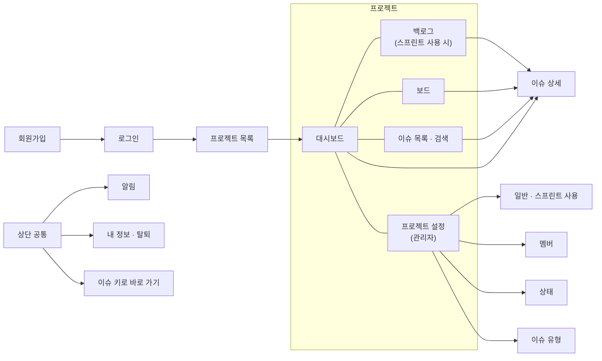

| 화면 | 들어가는 곳 | 기능 |
|---|---|---|
| 로그인 · 회원가입 | 첫 화면 | USER-1, 2 |
| 프로젝트 목록 | 로그인 후 첫 화면 | PRJ-1, 2 |
| 대시보드 | 프로젝트를 고르면 첫 화면 | DASH-1~8 |
| 백로그 | 프로젝트 메뉴. **스프린트 사용이 켜진 프로젝트만** | BACKLOG, SPRINT |
| 보드 | 프로젝트 메뉴 | BOARD-1~4 |
| 이슈 목록 · 검색 | 프로젝트 메뉴, 대시보드 위젯 클릭 | SEARCH-1~2 |
| 이슈 상세 | 어느 화면에서든 이슈를 누르면 | ISSUE, CMT |
| 프로젝트 설정 | 프로젝트 메뉴. **관리자만** | PRJ-3~7, WF |
| 알림 · 내 정보 · 키로 바로 가기 | 상단 공통 영역 | NOTI, USER-3~4, SEARCH-3 |

- 웹은 왼쪽 사이드바에 프로젝트 메뉴, 앱은 하단 탭에 대시보드 · 백로그 · 보드 · 이슈를 둔다.
- 이슈 상세는 웹은 오른쪽 패널(또는 모달), 앱은 새 화면으로 연다.

## 1. 시작하기

### 1-1. 회원가입 · 로그인 (USER-1, 2)

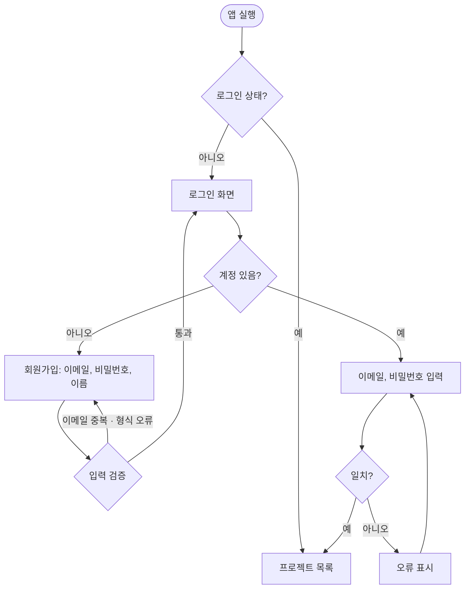

- 가입이 끝나면 로그인 화면으로 돌아가 이메일을 미리 채워 둔다.
- 로그인 실패 메시지는 "이메일 또는 비밀번호가 맞지 않습니다" 하나로 통일한다 (어느 쪽이 틀렸는지 알려주지 않는다).

### 1-2. 첫 프로젝트 만들기 (PRJ-1)

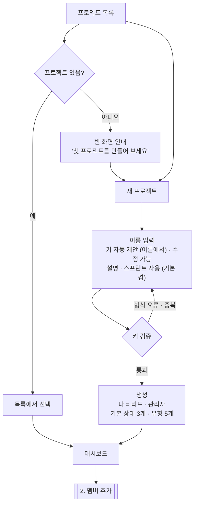

- 키는 이름을 입력하는 동안 자동으로 제안한다 (예: "Scheduler App" → `SA`). 사용자가 고칠 수 있다.
- 키 입력 칸 아래에 "키는 나중에 바꿀 수 없습니다"를 보여준다.

## 2. 멤버 관리 (PRJ-5~7)

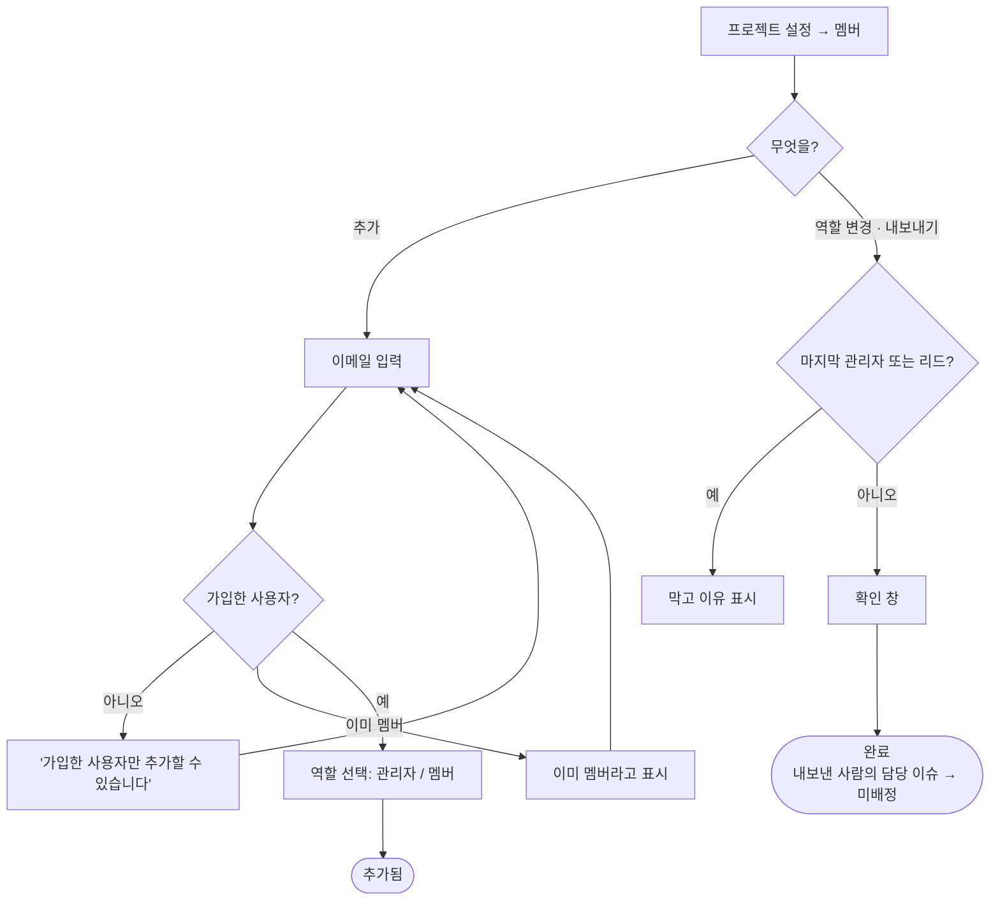

- 멤버(관리자 아님)에게는 설정 메뉴가 보이지 않는다. 대신 프로젝트 메뉴의 "나가기"만 있다 (리드·마지막 관리자는 막힘).

## 3. 이슈

### 3-1. 이슈 만들기 (ISSUE-1, BACKLOG-4)

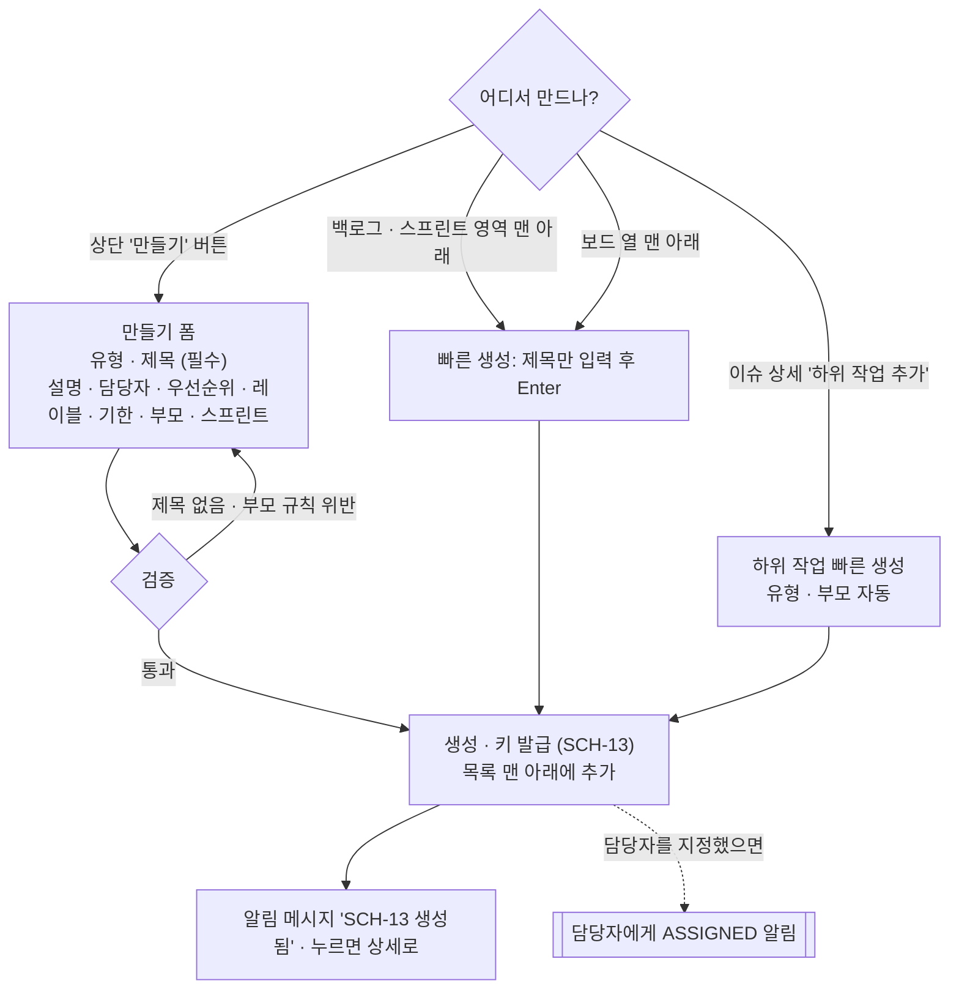

- 빠른 생성의 유형은 그 프로젝트의 첫 번째 `STANDARD` 유형(기본: 스토리)이고, 들어가는 곳에 따라 기본값이 정해진다.

| 만든 곳 | 스프린트 | 상태 |
|---|---|---|
| 백로그 영역 | 없음 (백로그) | `TODO` 분류의 첫 상태 |
| 스프린트 영역 | 그 스프린트 | `TODO` 분류의 첫 상태 |
| 보드 열 | 진행 중 스프린트 (스프린트 사용 끈 프로젝트는 없음) | 그 열의 상태 |

- 만들기 폼에서 유형을 고르면 부모 칸이 바뀐다: 에픽 → 부모 칸 숨김, 하위 작업 → 부모 필수.

### 3-2. 이슈 보고 고치기 (ISSUE-2~4, 6)

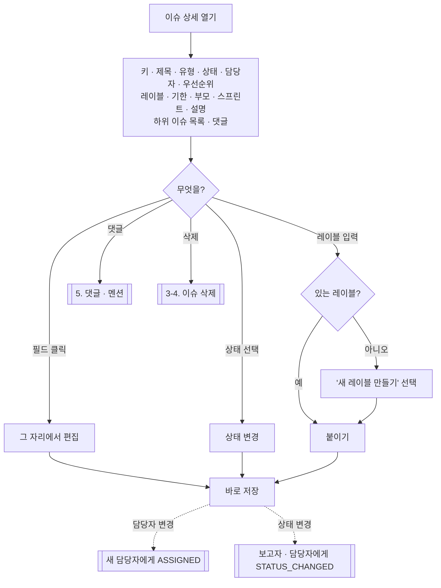

- 저장 버튼은 없다. 필드마다 바뀌는 즉시 저장한다. 실패하면 이전 값으로 되돌리고 오류를 보여준다.

### 3-3. 보드에서 진행하기 (BOARD-1~3)

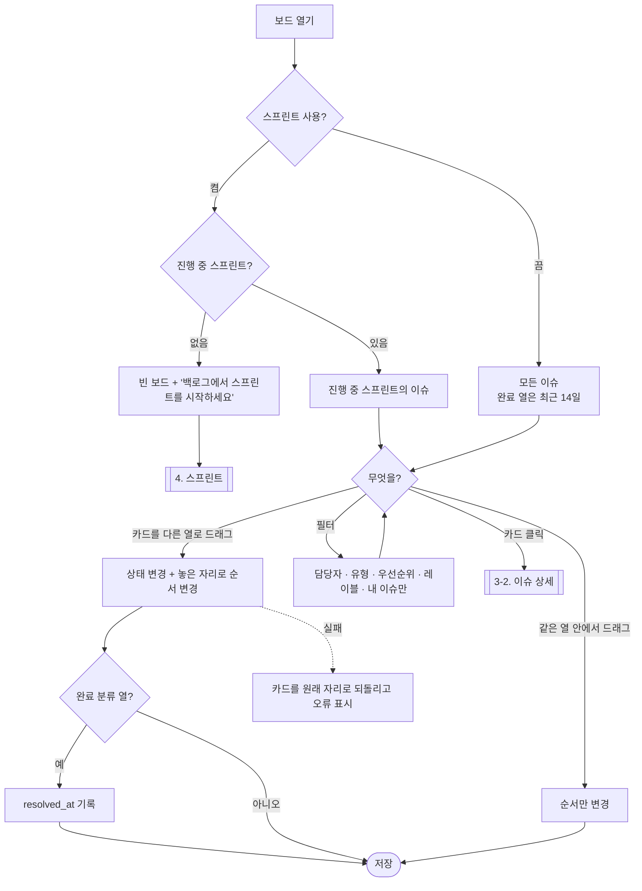

- 드래그는 화면에 먼저 반영하고 서버에 저장한다 (낙관적 업데이트). 실패하면 되돌린다.
- 앱: 열은 가로로 스와이프해 넘긴다. 카드를 길게 눌러 드래그하고, 화면 가장자리로 끌면 옆 열로 넘어간다. 드래그가 불편하면 카드 메뉴의 "상태 변경"을 쓴다.

### 3-4. 이슈 삭제 (ISSUE-5)

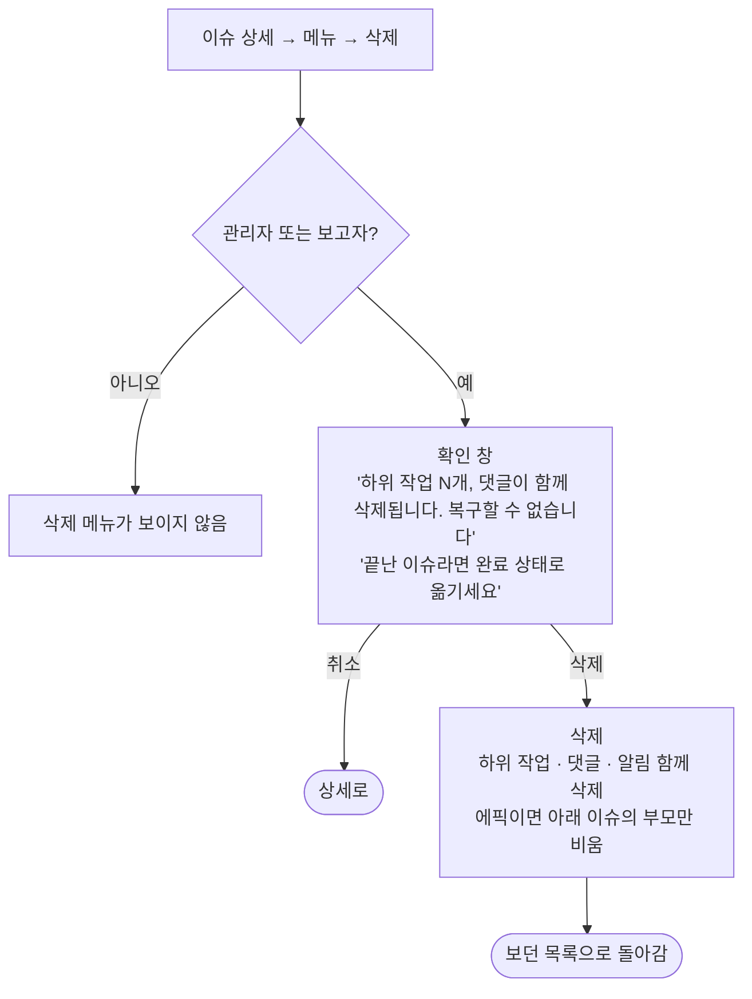

## 4. 스프린트 (BACKLOG, SPRINT)

스프린트 사용이 켜진 프로젝트에만 있다.

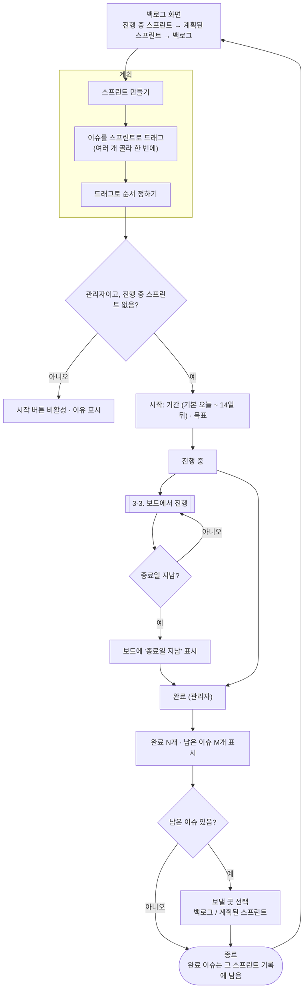

- 에픽은 스프린트로 드래그할 수 없다 (놓을 수 없음 표시). 하위 작업은 부모를 옮기면 따라간다.
- 계획된 스프린트 삭제: 스프린트 메뉴 → 삭제 → 확인 창 ("이슈 N개는 백로그로 돌아갑니다").

## 5. 댓글 · 멘션 (CMT-1, 2)

```mermaid
flowchart TD
    Detail[이슈 상세 → 댓글 입력] --> Type[내용 입력]
    Type --> At{'@' 입력?}
    At -- 예 --> Pick[프로젝트 멤버 목록에서 선택] --> Type
    At -- 아니오 --> Submit[등록]
    Submit --> Saved([댓글 표시])
    Saved -. 멘션된 사람 .-> N1[[MENTIONED]]
    Saved -. 보고자 · 담당자 .-> N2["COMMENTED<br/>(이미 멘션으로 받은 사람은 제외)"]

    Saved --> Mine{내 댓글?}
    Mine -- 예 --> EditDel[수정 · 삭제]
    Mine -- 아니오, 관리자 --> DelOnly[삭제만]
```

## 6. 알림 (NOTI-1~3)

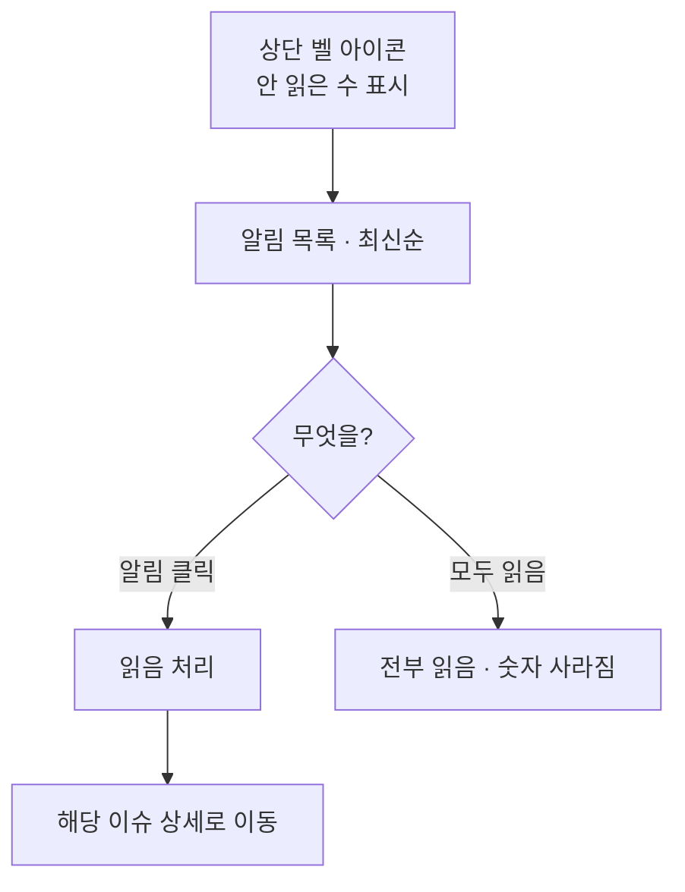

| 알림 문구 예 | 종류 |
|---|---|
| 김철수님이 **SCH-12**를 회원님에게 배정했습니다 | `ASSIGNED` |
| 김철수님이 **SCH-12** 댓글에서 회원님을 언급했습니다 | `MENTIONED` |
| 김철수님이 **SCH-12**에 댓글을 남겼습니다 | `COMMENTED` |
| 김철수님이 **SCH-12**를 **진행 중**으로 변경했습니다 | `STATUS_CHANGED` |

## 7. 대시보드 (DASH-1~8)

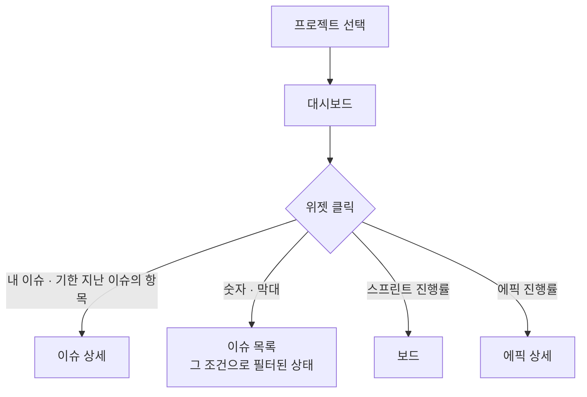

- 예: "담당자별 이슈 수"에서 김철수 막대를 누르면 → 이슈 목록이 `담당자 = 김철수, 미완료` 필터로 열린다.

## 8. 프로젝트 설정 (관리자)

### 8-1. 상태 · 이슈 유형 관리 (WF-1~5)

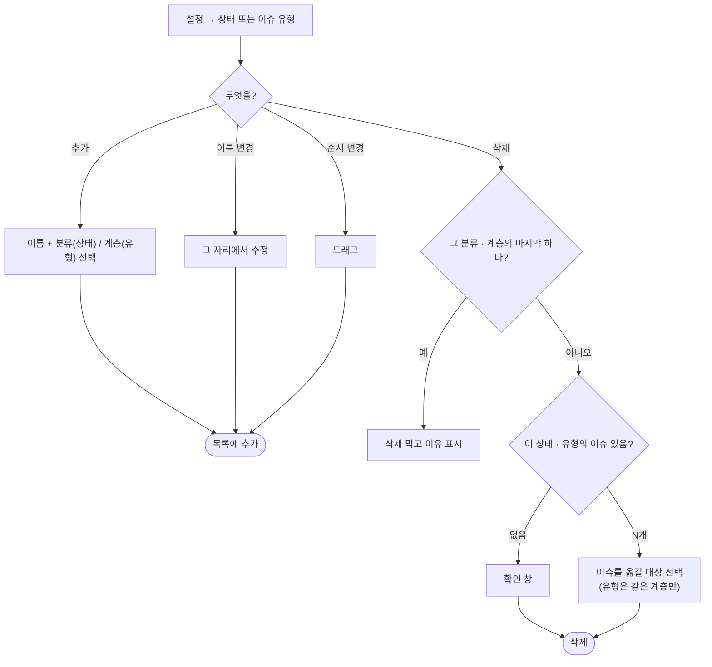

- 분류·계층은 만든 뒤 바꿀 수 없어서, 수정 화면에서는 읽기 전용으로 보여준다.

### 8-2. 스프린트 사용 바꾸기

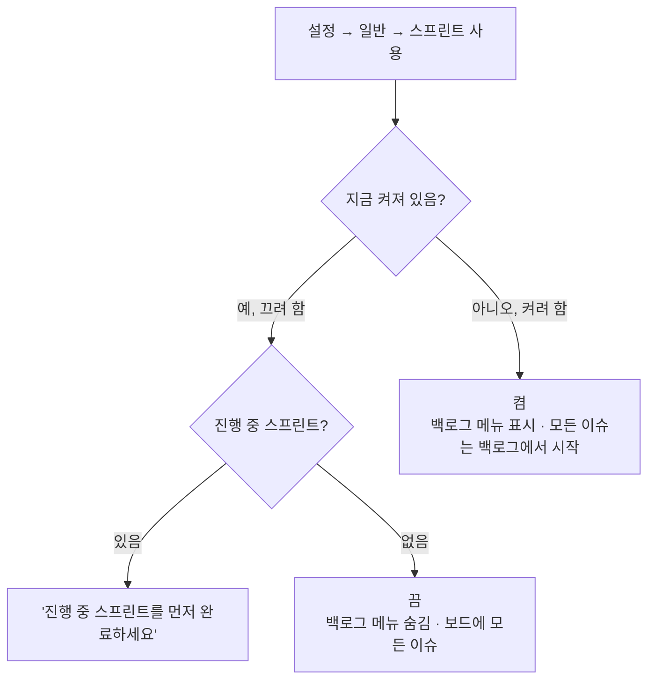

### 8-3. 프로젝트 삭제 (PRJ-4)

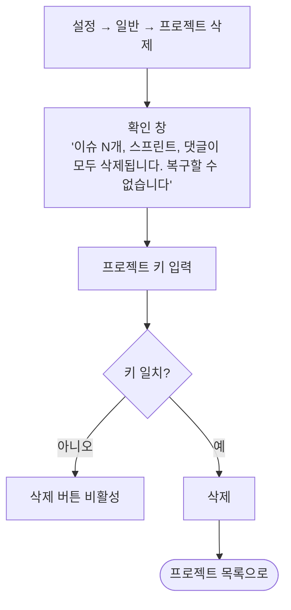

## 9. 탈퇴 (USER-4)

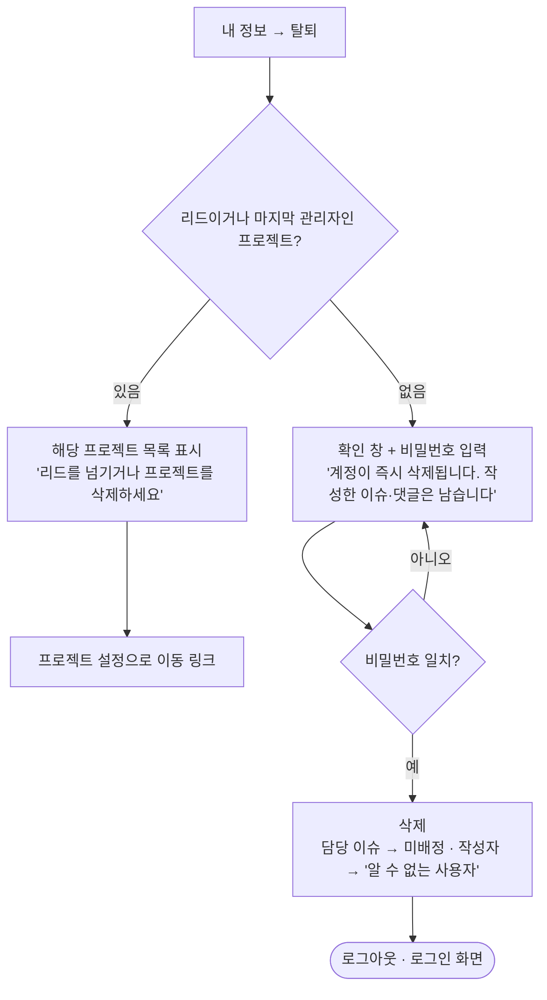
