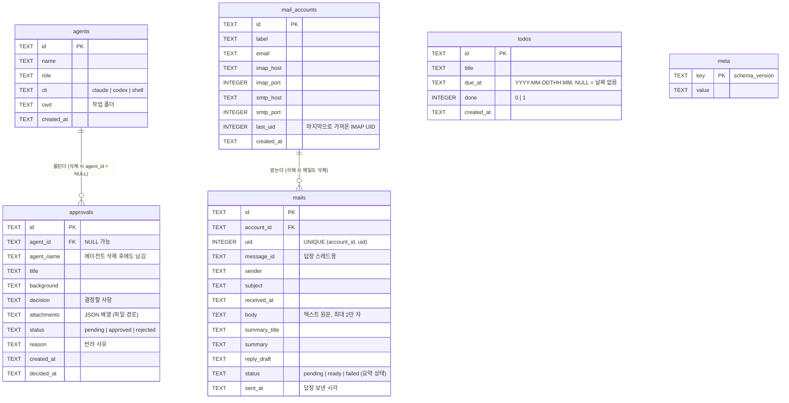

# ERD

지금 구현된 DB 구조. 스키마 원본은 `backend/app/db.py`의 `SCHEMA`다.

- DB: SQLite, `%APPDATA%\Scheduler\scheduler.db` (WAL 모드, 외래 키 켬)
- id는 모두 uuid4 hex 문자열, 시각은 로컬 시각 ISO 문자열(`YYYY-MM-DDTHH:MM:SS`)
- 메일 비밀번호는 DB에 없다. Windows 자격 증명 관리자(서비스 이름 `Scheduler mail`, 사용자 = 계정 id)에 있다.
- 에이전트 터미널 출력과 대화 기록은 DB에 저장하지 않는다. 앱이 켜져 있는 동안 메모리에만 있다(에이전트당 최근 약 25만 자).

## 다이어그램

## 테이블

| 테이블 | 쓰는 위젯 | 메모 |
|---|---|---|
| `todos` | 할 일, 일정(달력), 다가오는 일정 | 세 위젯이 같은 테이블을 본다 |
| `agents` | Agent, 터미널 | 세션 상태(`running` 등)는 DB가 아니라 실행 중인 프로세스로 판단한다 |
| `approvals` | 결재 대기 | 에이전트가 MCP `submit_approval`로 만든다. UI에서는 상태만 바꾼다 |
| `mail_accounts` | 메일 검토 (연결 관리) | 처음 연결하면 최근 메일 10통만 가져온다 |
| `mails` | 메일 검토 | `status`는 요약 상태, 답장 여부는 `sent_at` |
| `meta` | (없음) | 스키마 버전. 지금 `1` |

## 삭제 규칙

| 지우는 것 | 같이 일어나는 일 |
|---|---|
| 에이전트 | 터미널 세션 종료. 그 에이전트가 올린 결재는 남고 `agent_id`만 `NULL` |
| 메일 계정 | 받아 둔 메일 전부 삭제, 자격 증명 관리자의 비밀번호 삭제 |
| 할 일 | 그것만 삭제 |
