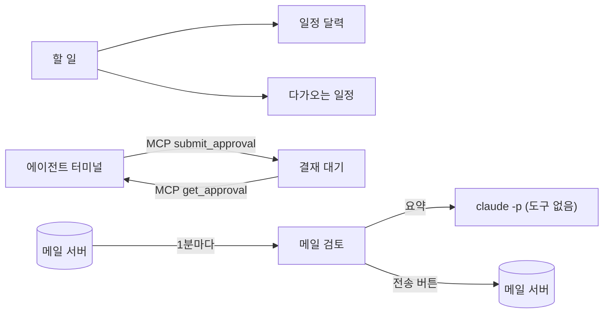

# 기능

지금 구현된 기능과, 할 수 있는 것·없는 것. 데이터 구조는 [ERD](erd.md), 요청 목록은 [API](api.md), 처음 기획은 [기획서](plan.md)와 [유저플로우](user-flow.md).

## 화면

| 왼쪽 | 가운데 | 오른쪽 | 사이드 패널 |
|---|---|---|---|
| 다가오는 일정 | 할 일 | 메일 검토 | 에이전트 터미널 |
| Agent | 일정(달력) | 결재 대기 | |

네 칸은 30 : 38 : 32 : 36 비율로 창 너비를 나눈다. 모니터 배율이 달라도 모양이 같다.

## 위젯별 기능

### 할 일 · 일정(달력) · 다가오는 일정

| 할 수 있는 것 | 할 수 없는 것 |
|---|---|
| 제목 + 날짜·시각(선택)으로 할 일 추가 | 화면에서 제목·날짜 수정 (API `PATCH`는 있음) |
| 체크해서 완료/취소, 삭제 | 반복 일정, 알림 |
| 날짜가 있는 할 일은 달력의 그 날짜에 표시, 달 넘기기 | 외부 캘린더(Google 등) 연동 |
| 다가오는 일정: 안 했고 시각이 지나지 않은 할 일 가까운 순 5개 | |

### Agent · 터미널

- 에이전트 하나 = 터미널 세션 하나. 종류는 `claude`(Claude Code), `codex`(Codex), `shell`(PowerShell만).
- 에이전트를 누르면 오른쪽 터미널이 그 세션으로 바뀐다. 다른 에이전트로 갔다 와도 세션은 그대로다.
- 에이전트를 추가할 때 작업 폴더를 비우면 에이전트 전용 폴더 `%APPDATA%\Scheduler\agents\{id}\workspace`를 만들어 준다. 경로는 터미널 위쪽에 보인다. 에이전트를 삭제해도 이 폴더는 남긴다(작업 결과가 있을 수 있어서).
- 세션은 `작업 폴더(cwd)`에서 PowerShell을 띄우고 CLI를 실행한다. Claude Code·Codex에는 결재용 MCP 서버(`scheduler`)를 자동으로 붙인다.

| 할 수 있는 것 | 할 수 없는 것 |
|---|---|
| 에이전트 추가(이름·역할·CLI·작업 폴더), 재시작, 삭제 | 에이전트 정보 수정 (지우고 다시 만들어야 함) |
| 터미널에 직접 입력, 작업 폴더 안 파일 작업 등 CLI가 할 수 있는 모든 것 | 할 일·메일·달력 읽기/쓰기 (에이전트에게 연결된 도구는 결재뿐) |
| MCP `submit_approval` / `get_approval`로 결재 올리고 결과 확인 | 앱을 껐다 켠 뒤 이전 터미널 출력 보기 (출력은 메모리에만 있음) |

### 메일 검토

- IMAP으로 1분마다 받은편지함(INBOX)을 확인한다. `동기화` 요청으로 바로 확인할 수도 있다.
- 새 메일은 도구를 모두 끈 Claude Code(`claude -p`)가 빈 폴더에서 요약한다: 요약 제목 · 3줄 요약 · 답장 초안. 메일 안의 지시는 따르지 않도록 프롬프트에 적어 두었다.
- 목록에는 요약 제목을 보여 준다. 요약에 실패하면 원래 제목으로 보여 준다.
- 답장은 초안을 고친 뒤 **전송 버튼을 눌러야만** SMTP로 보낸다. AI가 스스로 보내는 경로는 없다.

| 할 수 있는 것 | 할 수 없는 것 |
|---|---|
| Gmail·네이버(프리셋)·직접 입력(IMAP/SMTP) 계정 여러 개 연결, 연결 끊기 | 새 메일 작성 (답장만 가능) |
| 메일별 요약·원문·답장 초안 보기, 초안 수정 후 답장 전송 | 첨부 파일 보기·보내기 |
| 답장은 원래 메일에 스레드로 이어짐(`In-Reply-To`) | 읽음 표시 바꾸기 (메일함은 읽기 전용으로 연다) |
| | 받은편지함 외 폴더, 실시간 수신(IMAP IDLE) |
| | 처음 연결할 때 최근 3통보다 이전 메일 가져오기 |
| | 메일이 오면 할 일 추가·에이전트에게 넘기기 같은 자동 규칙(훅) |

### 결재 대기

- 에이전트가 터미널에서 일하다가 내가 정해야 할 일이 생기면 MCP `submit_approval`로 결재 문서를 올린다(제목, 결정할 사항, 배경, 첨부 파일 경로).
- 나는 승인하거나, 사유를 적고 반려한다. 한 번 처리한 결재는 다시 바꿀 수 없다.
- 에이전트는 `get_approval`로 결과를 확인하고 일을 이어 간다. 결과가 에이전트에게 자동으로 전달되지는 않는다(에이전트가 확인해야 한다).

## 기능끼리 연결

연결이 없는 것: 에이전트 ↔ 할 일, 에이전트 ↔ 메일, 메일 → 할 일. 필요하면 결재처럼 MCP 도구를 추가하는 방식으로 붙일 수 있다(`backend/app/approvals.py`의 `TOOLS`).

## 필요한 것

- Claude Code CLI(`claude`): 메일 요약, Claude Code 에이전트
- Codex CLI(`codex`): Codex 에이전트를 쓸 때만
- 메일 앱 비밀번호: Gmail은 2단계 인증 후 앱 비밀번호, 네이버는 IMAP/SMTP 사용 설정
