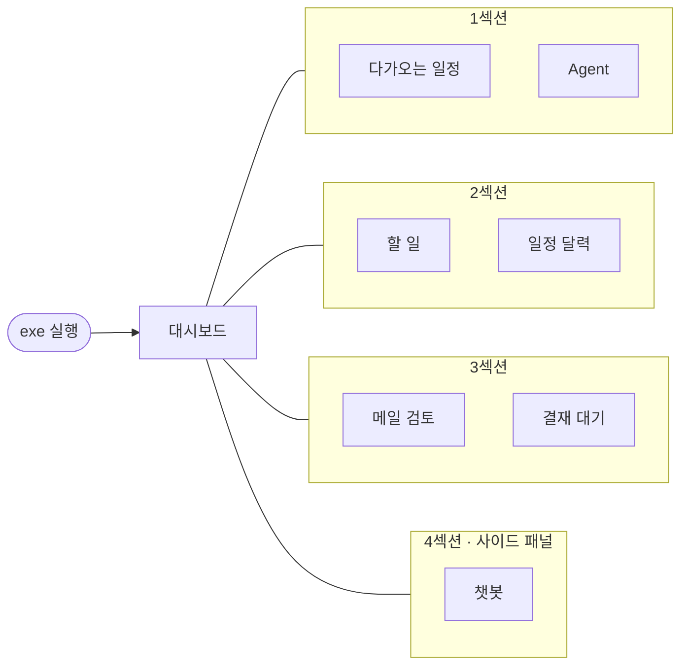
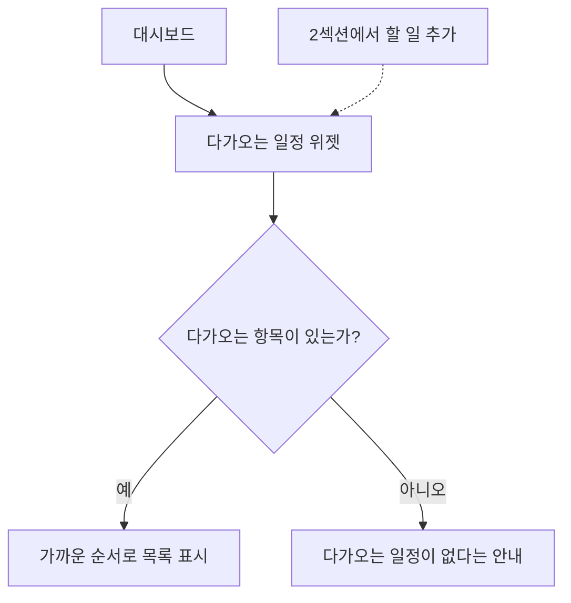
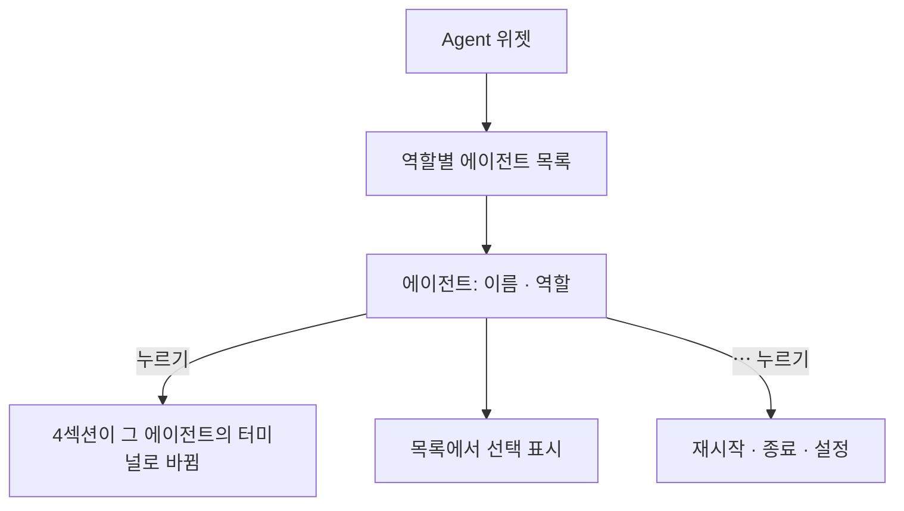
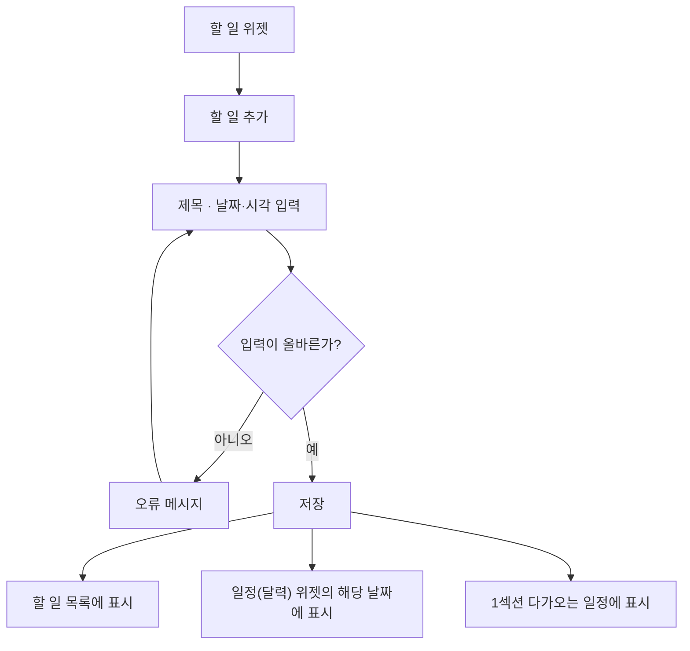
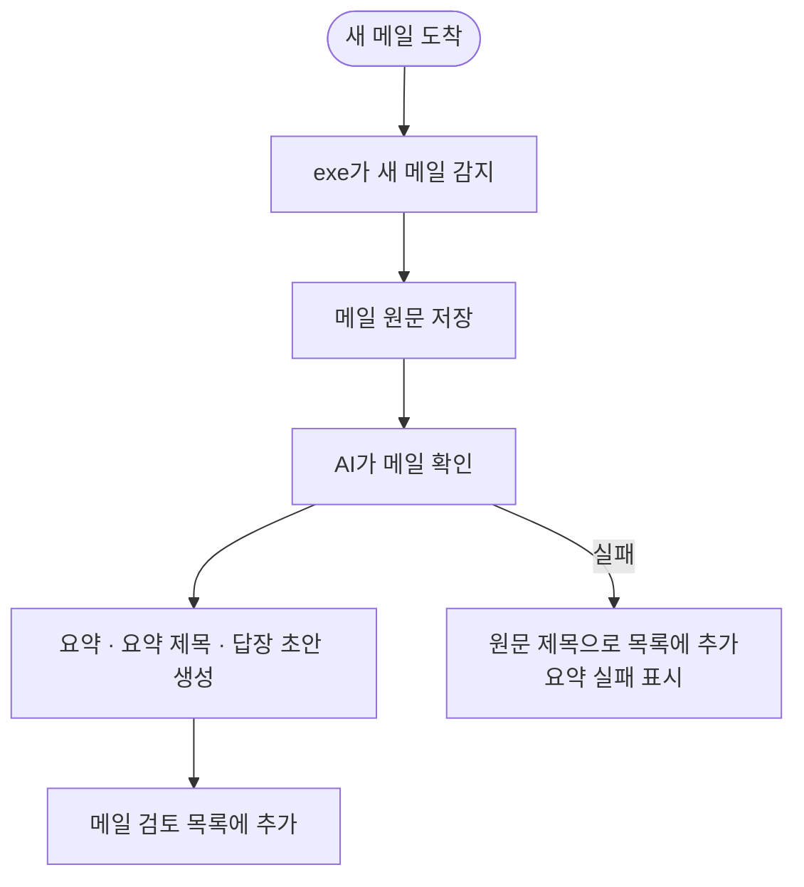
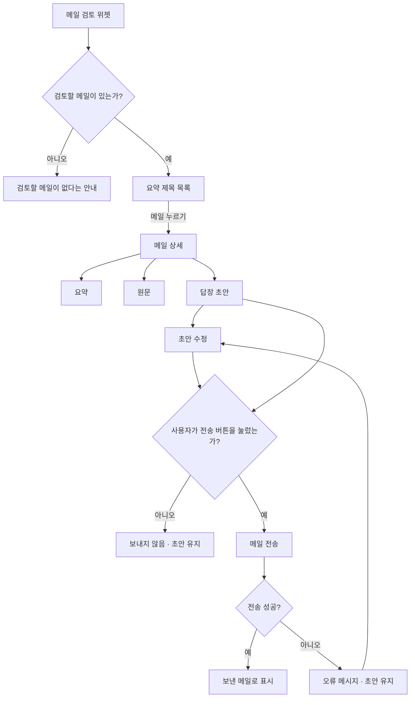
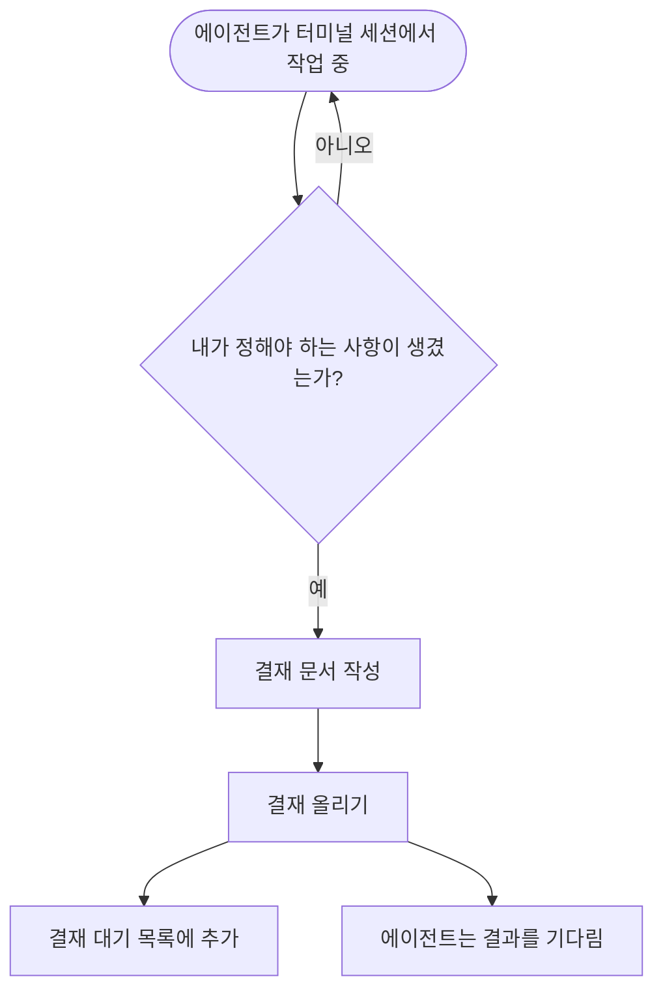
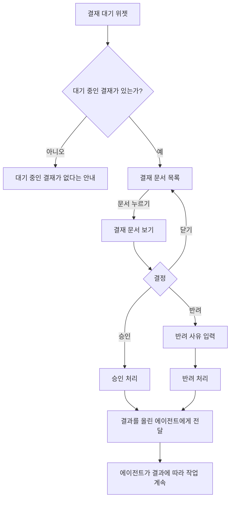
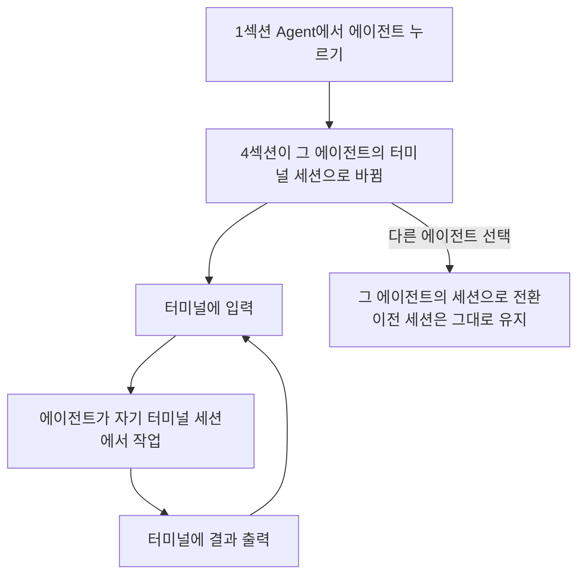

# User Flow

[기획서](plan.md)의 기능을 사용자가 어떤 순서로 쓰는지 정리한다. 나와 에이전트(터미널 세션)가 함께 일하는 exe 앱이다.

- 다이어그램은 Mermaid로 그려 GitHub에서 바로 보인다.
- 모양: `([ ])` 시작·끝, `[ ]` 화면·행동, `{ }` 분기.

## 화면 구조

exe를 실행하면 바로 대시보드가 열린다. 대시보드에는 섹션 4개가 있다.

## 플로우

### 1섹션: 다가오는 일정

- 보기 전용이다. 이 위젯에서는 일정을 추가·수정할 수 없다.
- 2섹션에서 추가한 할 일 중 다가오는 것을 가까운 순서로 보여 준다.

### 1섹션: Agent

- AI 팀원은 **역할별 에이전트 여러 개**다. 에이전트마다 맡은 역할이 다르다.
- **에이전트 하나 = 터미널 세션 하나.** 에이전트마다 자기 터미널 세션을 따로 가진다. 한 에이전트가 실행한 명령, 작업 폴더, 대화 기록은 다른 에이전트와 섞이지 않는다.
- 에이전트를 누르면 4섹션(사이드 패널)이 바로 그 에이전트의 터미널로 바뀐다. 지금 4섹션에 열린 에이전트는 목록에서 진하게 표시한다.
- 행 오른쪽 `⋯` 메뉴에 재시작·종료·설정 같은 동작을 둔다. (항목은 초안)
- 에이전트는 공식 CLI 에이전트(Claude Code, Codex 등)다. 로그인은 CLI가 처음 실행될 때 직접 한다.
- 에이전트를 누가 만들고 어떻게 관리하는지는 미정이다.

### 2섹션: 할 일 · 일정(달력)

- 할 일 위젯에서 할 일을 추가한다.
- 추가한 할 일은 일정(달력) 위젯의 해당 날짜에 보인다. 1섹션 다가오는 일정에도 나온다.
- 할 일 입력 항목은 초안이다: 제목, 날짜·시각.

### 3섹션: 메일 검토

- Gmail, 네이버, 회사 메일 등 어떤 메일이든 연결할 수 있게 한다.
- exe가 메일 서버와 IMAP IDLE 연결을 열어 두고, 새 메일이 오면 바로 감지한다(IDLE을 지원하지 않으면 1분마다 확인). 개인 컴퓨터는 밖에서 접속할 수 없어서, 메일 서비스가 알림을 보내 주는 방식은 쓰지 않는다.
- AI가 메일을 읽고 요약한다. 도구를 모두 끈 Claude Code(`claude -p`)를 빈 폴더에서 실행한다. 목록에는 메일 원래 제목 대신 **요약을 제목으로** 보여 준다.
- 메일을 누르면 **요약 · 원문 · 답장 초안**을 보여 준다.
- 답장은 **사용자가 전송 버튼을 눌러야만** 보내진다. AI는 초안만 쓰고, 스스로 메일을 보내지 않는다.
- 사용자는 초안을 고친 뒤 보낼 수 있다. (초안)
- 메일을 읽는 AI는 터미널을 쓰지 않는다. 메일 본문에 숨은 지시가 명령 실행으로 이어지지 않게 하기 위해서다.

새 메일이 들어올 때 (앱 내부):

사용자:

### 3섹션: 결재 대기

- 에이전트가 내가 정해야 하는 사항을 **결재 문서**로 작성해 올린다. 예: 제출물 확정, 클라이언트에게 보낼 내용.
- 명령 실행 승인은 결재가 아니다. CLI 안에서 처리한다.
- 결재 문서 항목은 초안이다: 제목, 올린 에이전트, 올린 시각, 배경, 결정할 사항, 첨부.
- 나는 **승인** 또는 **반려**한다. 반려할 때는 사유를 적는다.
- 결과는 문서를 올린 에이전트에게 전달되고, 에이전트는 결과에 따라 작업을 이어 간다.

에이전트가 결재를 올릴 때:

내가 결재할 때:

### 4섹션: 챗봇 (사이드 패널)

- 4섹션은 1섹션에서 고른 **에이전트의 터미널 세션**을 보여 주는 창이다. 터미널 화면을 그대로 보여 주고, 사용자는 그 터미널에 직접 입력한다.
- 입력하면 그 에이전트가 자기 터미널 세션에서 작업하고 결과를 터미널에 출력한다.
- 다른 에이전트로 바꾸면 그 에이전트의 세션으로 넘어간다. 돌아오면 이전 대화와 작업 상태가 그대로 남아 있다.
- 아직 고른 에이전트가 없을 때 무엇을 보여 줄지는 미정이다.

